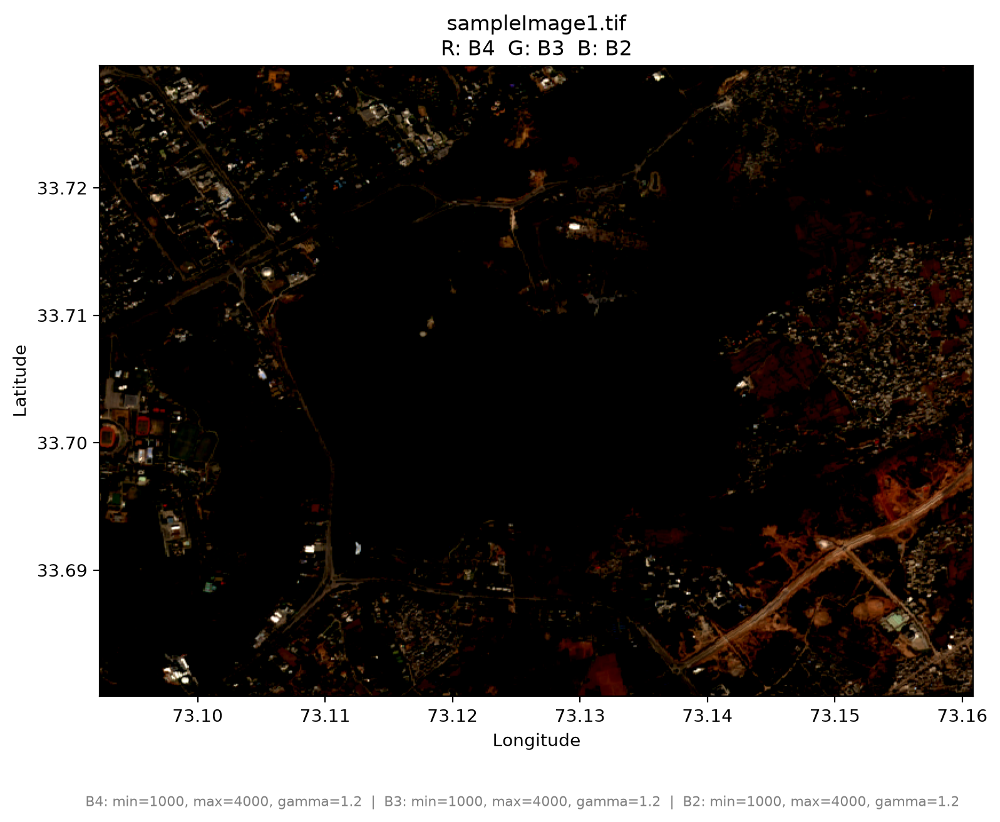
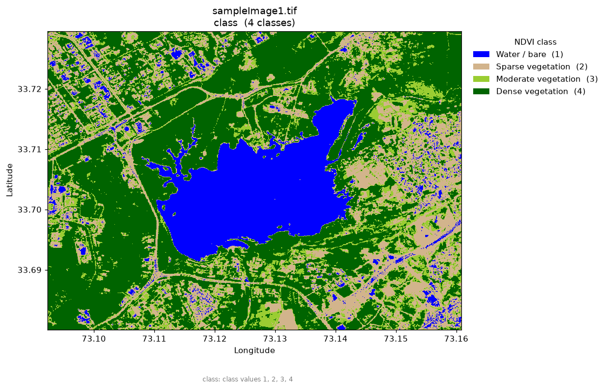
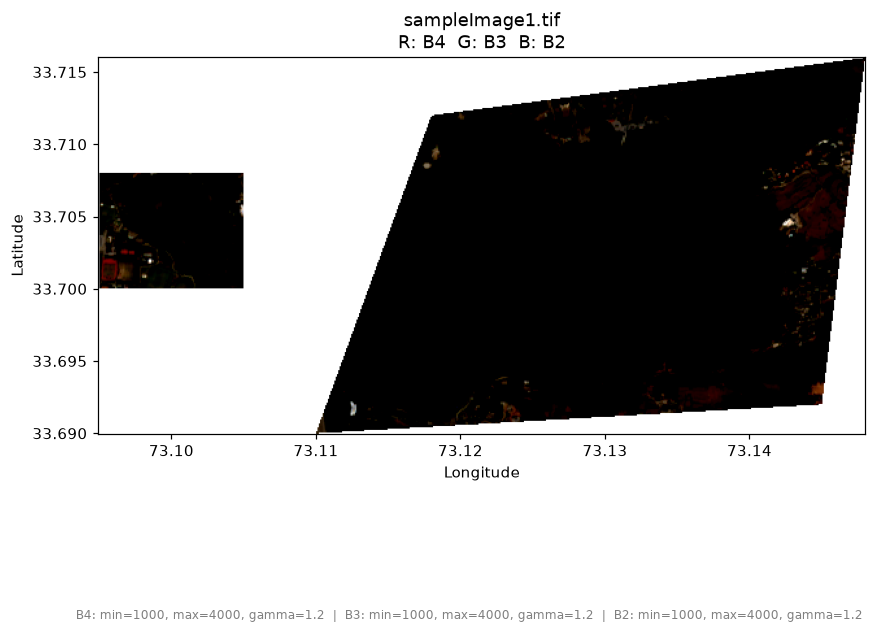

# EarthForge

A Python library for processing and visualizing GeoTIFF rasters, with vector support, built on [rasterio](https://rasterio.readthedocs.io/), geopandas and matplotlib. It provides band selection (`select()`, `bandNames().size()`), band math, comparisons, `normalizedDifference()`, `expression()`, reclassification with `where()` and `remap()`, picking and merging classes, clustering and PCA, clipping to vector boundaries, memory-safe mosaicking of many tiles, and `visualize()` with `min`/`max`/`gamma`/`palette`.

Images are **lazy**. Operations build a recipe, and pixels are read only when you visualize (as a downsampled preview) or save (streamed in blocks). Memory use stays small even for very large rasters, so it runs well on modest PCs.

> **Status:** early development (version 0.1). The API may still change.

## Installation

Requires Python 3.10+.

```bash
pip install git+https://github.com/msndma2025/EarthForge.git     # latest version from GitHub
pip install earthforge                                            # from PyPI, once published
pip install "earthforge[jupyter]"                                 # plus progress-bar widgets for Jupyter
```

Dependencies (installed automatically): `rasterio`, `numpy`, `matplotlib`, `tqdm`, `psutil`, `geopandas`, `pyogrio`, `shapely`, `pandas`, `pyproj`, `pyarrow`, `openpyxl`, `scikit-learn`. geopandas and scikit-learn are only imported when you use `vector`, `cluster` or `pca`.

For development (editable install, docs tools):

```bash
git clone https://github.com/msndma2025/EarthForge.git
cd EarthForge
pip install -e ".[docs]"
```

## Quick start

```python
from earthforge import raster, vector

img = raster.image("sampleImage1.tif")   # reads metadata only
img.meta()                               # print metadata, including band names
img.bandNames().size()                   # 26

# True-color composite
img.select("B4", "B3", "B2").visualize(gamma=1.2)

# NDVI with a built-in palette, saved as GeoTIFF
ndvi = img.normalizedDifference(["B8", "B4"], save="ndvi.tif").rename("NDVI")
ndvi.visualize(min=-0.2, max=0.8, palette="ndvi")

# Band math and expressions
ratio = img.select("B8") / img.select("B4")
evi = img.expression("2.5 * ((NIR - RED) / (NIR + 6 * RED - 7.5 * BLUE + 1))",
                     {"NIR": img.select("B8") * 0.0001, "RED": img.select("B4") * 0.0001,
                      "BLUE": img.select("B2") * 0.0001})

# Reclassify, shown with a legend
classes = ndvi.where((ndvi.lt(0.1), 1), (ndvi.gte(0.1).And(ndvi.lt(0.5)), 2),
                     (ndvi.gte(0.5), 3), otherwise=0)
classes.visualize(labels={1: "Water / bare", 2: "Sparse", 3: "Dense"},
                  palette=["0000FF", "D2B48C", "006400"])

# Pick and merge classes
dense = classes.eq(3)                            # 1 where class 3
veg = classes.selectClasses([2, 3])              # keep classes 2 and 3 only
merged = classes.mergeClasses([2, 3], into=2)

# Vectors: open, inspect, filter, add columns, join, clip
from earthforge.vector import Filter
stations = vector.Open("sample_data/stations.csv")             # 600 sample points
stations.filter(Filter.eq("district", "North") & Filter.gt("rain_mm", 20)).show()
stations = stations.map(lambda f: f.set({"rain_cm": f.get("rain_mm") / 10}))
with_zone = stations.spatialJoin(vector.Open("sample_data/districts.geojson"))

aoi = vector.Open("boundary.shp")                # also geojson, kml, kmz, gpkg, parquet, csv, xlsx
aoi.meta()
aoi.columns()
ndvi.clip(aoi).visualize(min=-0.2, max=0.8, palette="ndvi")
img.geometry().save("extent.geojson")

# Mosaic many tiles without loading them (streamed in parallel, with a progress bar)
raster.mosaic("tiles/").save("mosaic.tif")

# Clustering and PCA
from earthforge import cluster, pca
trained = cluster.wekaKMeans(5).train(img.select("B2", "B3", "B4", "B8"), numPixels=5000)
img.cluster(trained).visualize(labels={i: f"Cluster {i}" for i in range(5)})
pcs = img.pca(pca.PCA(3).train(img.select("B2", "B3", "B4", "B8", "B11", "B12")))

# One file per band, and back again
img.select("B2", "B3", "B4", "B8").split(save="bands/")
stacked = raster.stack("bands/")

raster.showPalettes()                    # see every available palette
```

  

## Documentation

The documentation is a searchable website built with MkDocs Material. It includes an API reference generated from the docstrings. [documentation.html](documentation.html) is the same documentation as one file with search: download it and open it in a browser, offline.

```bash
pip install -e ".[docs]"
mkdocs serve          # open http://127.0.0.1:8000
```

The same pages can also be read directly as Markdown:

| Page | Contents |
|---|---|
| [docs/index.md](docs/index.md) | Home: features, quick start, cheat sheet |
| [docs/raster.md](docs/raster.md) | `raster.image()` and the `Image` class: `select`, `rename`, `addBands`, `geometry`, `clip`, `updateMask`, `bandNames`, `meta`, `save`, `visualize` |
| [docs/band-math.md](docs/band-math.md) | Arithmetic, operators, comparisons and logic (`lt`, `gt`, `And`, …), `normalizedDifference`, the `save` argument, recipes |
| [docs/expressions.md](docs/expressions.md) | `expression()`: text formulas |
| [docs/reclassify.md](docs/reclassify.md) | `where()` reclassification, picking and merging classes (`eq`, `selectClasses`, `mergeClasses`), `remap()`, class maps with legends |
| [docs/clustering.md](docs/clustering.md) | Clustering images and tables: k-means variants, cascade, X-means, Gaussian mixture |
| [docs/pca.md](docs/pca.md) | Principal component analysis of images and tables |
| [docs/mosaic.md](docs/mosaic.md) | `raster.mosaic()`: combining tiles without loading them, methods, data types, tips for large mosaics |
| [docs/vector.md](docs/vector.md) | `vector.Open()`, supported formats, tables, `meta`, `columns`, `toGeoJSON`, `save` |
| [docs/palettes.md](docs/palettes.md) | Built-in palettes, matplotlib colormaps, custom color lists, legends, colorbar options |
| [docs/api.md](docs/api.md) | API reference (generated from docstrings on the website) |
| [docs/performance.md](docs/performance.md) | How memory is kept low, measured benchmarks, tips |
| [docs/math.md](docs/math.md) | `add`, `subtract` (plain-number helpers) |
| [docs/errors.md](docs/errors.md) | Exceptions raised by the library and what causes them |
| [CHANGELOG.md](CHANGELOG.md) | What changed in each version |

## Sample data

`sample_data/` contains example datasets covering `sampleImage1.tif`: `stations.csv` (600 points), `survey.xlsx` (several sheets) and `districts.geojson` (5 polygons). Recreate them with `python sample_data/make_sample_data.py`.

## Package layout

```
earthforge/
├── __init__.py    # public API: add, subtract, raster, vector, cluster, pca, errors, FULL_TRACEBACKS
├── add.py
├── subtract.py
├── raster.py      # Image class, raster.image(), palettes, lazy evaluation engine
├── vector.py      # Vector, Feature, Filter, vector.Open(), vector.layers()
├── cluster.py     # clustering methods (kMeans, wekaKMeans, ...)
├── pca.py         # principal component analysis
└── _errors.py     # internal: short, clean error messages
```

Everything listed in `earthforge/__init__.py` (`__all__`), plus the public names in `raster` (`image`, `mosaic`, `stack`, `Image`, `BandList`, `palettes`, `showPalettes`, `PALETTES`) and `vector` (`Open`, `layers`, `Vector`, `Feature`, `Filter`, `ColumnList`, `VectorNotFoundError`, `VectorReadError`), is public API. Names starting with `_` are internal and may change without notice.

## License

MIT. See [LICENSE](LICENSE).
