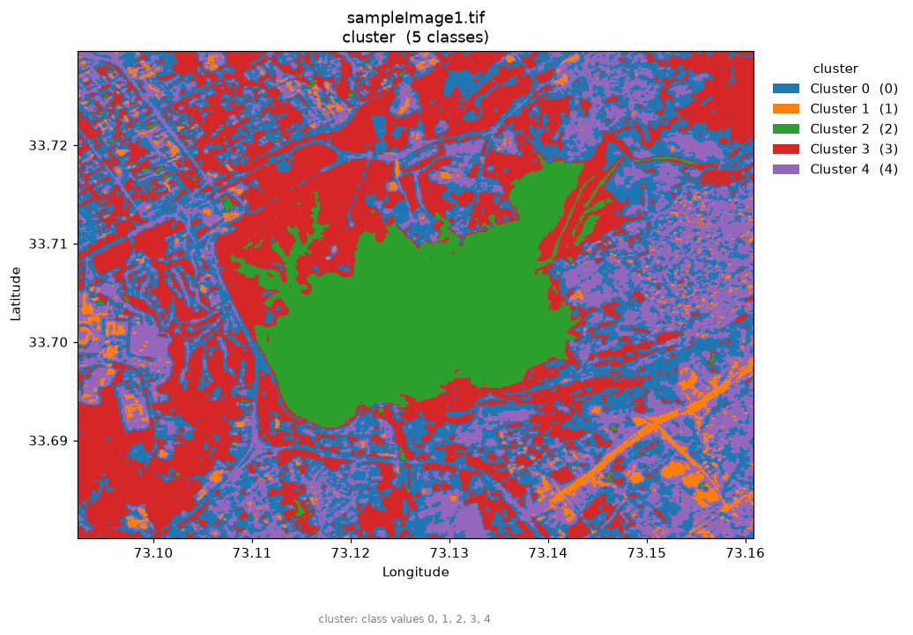

# Clustering

Clustering (unsupervised classification) groups pixels or table rows with similar values, without training labels. You choose a method, **train** it on a sample, and **apply** it to an image or a dataset.

```python
from pyearthforge import raster, cluster

img = raster.image("sampleImage1.tif").select("B2", "B3", "B4", "B8", "B11", "B12")

trained = cluster.wekaKMeans(5, init="kmeans++", restarts=3).train(img, numPixels=5000)
trained.info()                                   # sizes and centres of the clusters

clusters = img.cluster(trained)                  # lazy: one band named "cluster" (0, 1, 2, ...)
clusters.visualize(labels={i: f"Cluster {i}" for i in range(5)})
clusters.save("clusters.tif")                    # streamed block by block; uint8, NoData = 255
```

{ width="80%" }

Water (cluster 2) and the bright roads and buildings (cluster 1) stand out clearly. The cluster numbers themselves have no meaning: compare `trained.centers()` with what you know about the area to name them.

- [The three steps](#the-three-steps)
- [Methods](#methods)
- [Training: `train()`](#training-train)
- [Training inside a region](#training-inside-a-region)
- [Applying: `img.cluster()` and `vector.cluster()`](#applying-imgcluster-and-vectorcluster)
- [Inspecting a trained clusterer](#inspecting-a-trained-clusterer)
- [Choosing the number of clusters](#choosing-the-number-of-clusters)
- [Clustering tables](#clustering-tables)
- [Memory and speed](#memory-and-speed)
- [Tips](#tips)

---

## The three steps

| Step | Code | What happens |
|---|---|---|
| 1. Choose a method | `c = cluster.wekaKMeans(5)` | Nothing is computed yet. |
| 2. Train | `trained = c.train(img, numPixels=5000)` | A random sample of pixels is read and the clusters are learned from it. |
| 3. Apply | `img.cluster(trained)` / `table.cluster(trained)` | Every pixel or row gets the number of its nearest cluster. Images stay lazy. |

Steps 2 and 3 can also be done in one call: `img.cluster(cluster.kMeans(5), region=aoi)`.

Training on a sample keeps it fast and light on memory. A few thousand pixels are usually enough to find the main groups.

---

## Methods

All methods are created by a function in `cluster`. All of them have a `normalize` option, which scales every input to 0–1 before clustering so that inputs with large values (e.g. B8 near 3000) don't outweigh small ones.

| Function | Groups by | Chooses the number of clusters | `normalize` default |
|---|---|---|---|
| `cluster.kMeans(nClusters)` | nearest centre (k-means++ start, several restarts) | no | `False` |
| `cluster.wekaKMeans(nClusters, init, distanceFunction)` | nearest centre; options in the style of Weka's SimpleKMeans | no | `True` |
| `cluster.wekaCascadeKMeans(minClusters, maxClusters)` | nearest centre | **yes**, best Calinski–Harabasz score | `True` |
| `cluster.wekaXMeans(minClusters, maxClusters)` | nearest centre | **yes**, best BIC | `True` |
| `cluster.miniBatchKMeans(nClusters)` | nearest centre, trained on small batches: fast for large samples | no | `False` |
| `cluster.bisectingKMeans(nClusters)` | splits the largest cluster in two until there are `nClusters` | no | `False` |
| `cluster.gaussianMixture(nClusters, covariance)` | most likely of `nClusters` Gaussian groups; clusters can be stretched, not just round | no | `False` |

### `cluster.kMeans(nClusters, maxIterations=300, restarts=4, normalize=False)`

Standard k-means. Every pixel goes to the nearest of `nClusters` centres, and each centre is the mean of its pixels.

```python
trained = cluster.kMeans(5).train(img, numPixels=5000)
trained = cluster.kMeans(5, normalize=True, restarts=10).train(img)
```

### `cluster.wekaKMeans(nClusters, init="random", distanceFunction="Euclidean", maxIterations=500, restarts=1, normalize=True)`

k-means with the options of Weka's SimpleKMeans:

| Parameter | Options |
|---|---|
| `init` | `"random"`: random samples as first centres. `"kmeans++"`: spread-out centres, picked by probability. `"farthestFirst"`: each next centre is the sample farthest from those chosen so far. |
| `distanceFunction` | `"Euclidean"` (straight-line distance; centres are means) or `"Manhattan"` (sum of differences; centres are **medians**, which is less sensitive to outliers). |
| `restarts` | Runs with different starts; the one with the lowest total distance is kept. |
| `normalize` | `True` by default, as in Weka. |

```python
trained = cluster.wekaKMeans(5).train(img)
trained = cluster.wekaKMeans(6, init="kmeans++", distanceFunction="Manhattan", restarts=5).train(img)
trained = cluster.wekaKMeans(4, init="farthestFirst").train(img)
```

### `cluster.wekaCascadeKMeans(minClusters=2, maxClusters=10, restarts=10, init="random", maxIterations=500, normalize=True)`

Tries every number of clusters from `minClusters` to `maxClusters` and keeps the one with the best **Calinski–Harabasz** score (clusters that are compact and far apart), in the style of Weka's CascadeSimpleKMeans.

```python
trained = cluster.wekaCascadeKMeans(2, 8).train(img, numPixels=5000)
trained.nClusters          # the number it chose
trained.info()             # the score for every number tried
```

### `cluster.wekaXMeans(minClusters=2, maxClusters=8, restarts=3, init="kmeans++", maxIterations=500, normalize=True)`

Like the cascade, but chooses the number of clusters with the **Bayesian Information Criterion (BIC)**, which rewards a good fit and penalizes extra clusters (the X-means idea of Pelleg and Moore, as in Weka's XMeans).

```python
trained = cluster.wekaXMeans(2, 10).train(img, numPixels=5000)
```

### `cluster.miniBatchKMeans(nClusters, batchSize=1024, maxIterations=100, normalize=False)`

A faster k-means that updates the centres from small random batches. Use it to train on large samples (50,000+ pixels).

```python
trained = cluster.miniBatchKMeans(6).train(img, numPixels=50000)
```

### `cluster.bisectingKMeans(nClusters, normalize=False)`

Starts with one cluster and keeps splitting the largest one in two. The clusters tend to be more even in size.

```python
trained = cluster.bisectingKMeans(5).train(img)
```

### `cluster.gaussianMixture(nClusters, covariance="full", normalize=False)`

Models the data as a mix of Gaussian (bell-shaped) groups. `covariance` sets their shape: `"full"` (any shape), `"diag"` (aligned with the axes), `"spherical"` (round) or `"tied"` (all the same shape).

```python
trained = cluster.gaussianMixture(5).train(img)
trained = cluster.gaussianMixture(4, covariance="diag").train(img)
```

On data with 4 clearly separated groups, every method finds them exactly (adjusted Rand index 1.0 in our tests), and the cascade and X-means both choose 4 clusters on their own.

---

## Training: `train()`

```python
Clusterer.train(data, inputProperties=None, numPixels=5000, seed=0, region=None)
```

| Parameter | Type | Default | Description |
|---|---|---|---|
| `data` | `Image` or `Vector` | – | **Image:** `numPixels` random pixels are sampled with [`img.sample()`](raster.md#imagesample). **Vector** (a table, a CSV, or `img.sample()` output): its numeric columns are used. |
| `inputProperties` | list of `str` | all | The bands or columns to learn from. Default: all bands, or all numeric columns. |
| `numPixels` | `int` | `5000` | Pixels to sample from an image. |
| `seed` | `int` | `0` | Random seed for the sample and the clustering: the same seed gives the same result. |
| `region` | `Vector` | – | Train only on pixels (or rows) inside these shapes, e.g. your study area. The trained clusterer can still be applied to the whole image. |

**Returns:** a `TrainedClusterer`.

**Raises:** `ValueError` if there are fewer valid samples than clusters, or a column is missing or not numeric; `TypeError` if `data` isn't an Image or a Vector, or `region` isn't a Vector.

Pixels or rows with NoData in any input are left out of training.

```python
trained = cluster.kMeans(5).train(img, numPixels=10000, seed=1)
trained = cluster.kMeans(5).train(img, inputProperties=["B4", "B8", "B11"])   # some bands only

samples = img.sample(5000)                      # or train on a sample you keep
trained = cluster.kMeans(5).train(samples)

aoi = vector.Open("boundary.shp")
trained = cluster.kMeans(5).train(img, region=aoi)          # learn inside the boundary only
img.cluster(trained)                                         # ...and apply everywhere
```

---

## Training inside a region

Pass `region=` (any [vector](vector.md): a boundary, a district, a field) to learn the clusters from that area only. Every training pixel is drawn **inside** the shapes, and you still get the full `numPixels`. Regions in another CRS are reprojected automatically.

```python
from pyearthforge import vector

districts = vector.Open("sample_data/districts.geojson")
central = districts.filter(vector.Filter.eq("district", "Central"))

# two steps: train inside the region, then apply
trained = cluster.wekaKMeans(4, restarts=3).train(img, region=central, numPixels=3000)
trained.centers()
img.cluster(trained)                         # the whole image, with clusters learned in Central
img.clip(central).cluster(trained)           # or just the region

# one step: train inside the region and apply
clusters = img.cluster(cluster.wekaKMeans(4, restarts=3), region=central, numPixels=3000)
```

Both forms give the same result. The clusters describe the land covers **of the region**. In the Central district, which is mostly lake, 69% of the training pixels fall into one cluster with very low NIR (B8) and SWIR (B11, B12) values, which is water. The other three split the shore, vegetation and built-up areas more finely than clusters learned on the whole image would.

| Use | Code |
|---|---|
| Train inside a region, apply to the whole image | `img.cluster(cluster.kMeans(5).train(img, region=aoi))` |
| Train inside a region, keep only the region | `img.clip(aoi).cluster(cluster.kMeans(5), region=aoi)` |
| Train on the whole image, show only the region | `img.clip(aoi).cluster(cluster.kMeans(5).train(img))` |

### Sampling with your own geometry

The region can be any geometry you define yourself. No file is needed (see [Creating your own geometries](vector.md#creating-your-own-geometries)):

```python
from pyearthforge import vector

# a rectangle from coordinates (longitude, latitude)
box = vector.Rectangle(73.11, 33.69, 73.14, 33.71)
trained = cluster.kMeans(4).train(img, region=box)
trained.info()

# a polygon from its corners
lake = vector.Polygon([(73.110, 33.690), (73.145, 33.692), (73.148, 33.716), (73.118, 33.712)])
clusters = img.cluster(cluster.wekaKMeans(4), region=lake)       # train inside the polygon and apply

# a circle of 500 m around a point
circle = vector.Point(73.125, 33.700).buffer(500)
trained = cluster.gaussianMixture(3).train(img, region=circle, numPixels=2000)

# a shape drawn on geojson.io (paste the GeoJSON), or WKT text
drawn = vector.fromGeometry({"type": "Polygon", "coordinates": [[[73.11, 33.69], [73.14, 33.69],
                                                                 [73.14, 33.71], [73.11, 33.69]]]})
wkt = vector.fromGeometry("POLYGON ((73.11 33.69, 73.14 33.69, 73.14 33.71, 73.11 33.69))")
trained = cluster.wekaCascadeKMeans(2, 6).train(img, region=drawn)

# coordinates in another CRS (UTM metres): reprojected automatically
box_utm = vector.Rectangle(323500, 3729500, 326500, 3731500, crs="EPSG:32643")
trained = cluster.kMeans(4).train(img, region=box_utm)

# several training areas at once, e.g. one per land cover you care about
from shapely.geometry import box as shape_box
areas = vector.fromGeometry([shape_box(73.10, 33.70, 73.11, 33.71), shape_box(73.15, 33.68, 73.16, 33.69)],
                            properties={"name": ["urban sample", "farm sample"]})
trained = cluster.kMeans(5).train(img, region=areas)             # pixels from both areas
```

You can also sample first and keep the sample, for example to inspect or save it, then train on it:

```python
samples = img.sample(5000, region=lake)         # 5,000 pixels, all inside the polygon
samples.show(5)
samples.visualize()                             # where the samples are
samples.save("training_pixels.geojson")
trained = cluster.kMeans(4).train(samples)
```

All `numPixels` are drawn inside the geometry, as long as it covers that many pixels.

---

## Applying: `img.cluster()` and `vector.cluster()`

### `Image.cluster(clusterer, outputName="cluster", numPixels=5000, seed=0, region=None)`

Assigns every pixel to a cluster. The result is a **lazy** single-band image of cluster numbers (0, 1, 2, ...), so you can visualize, clip or save it like any other image. Pixels with NoData in any input band stay NoData.

Give a **trained** clusterer, or an **untrained** one (`cluster.kMeans(5)`) to train it on this image in the same step. When training this way, `numPixels`, `seed` and `region` control the training sample.

```python
clusters = img.cluster(cluster.kMeans(5))                        # train and apply in one step
clusters = img.cluster(cluster.kMeans(5), numPixels=20000, seed=3)
clusters = img.cluster(cluster.kMeans(5), region=aoi)            # trained inside aoi
```

```python
clusters = img.cluster(trained)
clusters.visualize(labels={0: "Vegetation", 1: "Built-up", 2: "Water", 3: "Forest", 4: "Mixed"},
                   palette=["9ACD32", "D7191C", "1F78B4", "006400", "D2B48C"])
clusters.save("clusters.tif")                    # uint8, NoData = 255
img.clip(aoi).cluster(trained)                   # cluster just an area
clusters.eq(2)                                   # a mask of one cluster
```

The image must have the bands the clusterer was trained on (`trained.schema()`). Extra bands are ignored.

### `Vector.cluster(clusterer, outputName="cluster", columns=None, region=None)`

Adds a column with each feature's cluster number. Rows with an empty input get an empty cluster. With an untrained clusterer, it's trained on this dataset's `columns` (default: all numeric columns), using only the features inside `region` if given. See [Clustering tables](#clustering-tables).

---

## Inspecting a trained clusterer

| Member | Returns |
|---|---|
| `trained.nClusters` | Number of clusters (the chosen number, for cascade and X-means). |
| `trained.schema()` | The bands or columns it was trained on. |
| `trained.centers()` | The cluster centres in the original units, as a table (one row per cluster). |
| `trained.info()` | Prints the method, settings, cluster sizes, centres and scores; returns them as a dict. |

```python
trained.nClusters                 # 5
trained.schema()                  # ['B2', 'B3', 'B4', 'B8', 'B11', 'B12']
trained.centers()                 # one row per cluster
trained.info()
```
```
========================================================
 Clusterer   : wekaKMeans
 Settings    : nClusters=5, init='kmeans++', distanceFunction='Euclidean', maxIterations=500, restarts=3, normalize=True
 Inputs      : ['B2', 'B3', 'B4', 'B8', 'B11', 'B12']
 Samples     : 5000
 Clusters    : 5
 Sizes       : [1401, 145, 795, 1635, 1024]
 Centres:
                   B2         B3         B4         B8        B11        B12
   cluster
   0         522.7630   713.1049   745.8926  2215.2709  1947.2819  1378.0546
   1        1512.1621  1836.3966  2200.4310  2866.3069  2991.3448  2749.1690
   2         285.8774   375.4748   260.3239   204.0805   121.3849    79.5459
   ...
========================================================
```

Cluster 2 has very low values in every band, including NIR (B8) and SWIR (B11, B12), which is typical of **water**. Cluster 1 is bright in every band (**roads, roofs**).

---

## Choosing the number of clusters

- **You know roughly how many classes you expect:** use `kMeans` or `wekaKMeans` with that number, or a few more and merge some afterwards with [`mergeClasses()`](reclassify.md#picking-and-merging-classes).
- **You don't:** let `wekaCascadeKMeans` or `wekaXMeans` choose within a range, and look at the scores in `info()`. Real images often have no single "right" number. When the score keeps improving up to `maxClusters`, the data supports more detail, so pick the number that is most useful for your map.

---

## Clustering tables

Tables and vector datasets are clustered on their numeric columns. Because columns often have different units, use `normalize=True`.

```python
from pyearthforge import vector, cluster

stations = vector.Open("sample_data/stations.csv")
trained = cluster.kMeans(4, normalize=True).train(
    stations, inputProperties=["ndvi", "elevation_m", "temp_c"])
grouped = stations.cluster(trained)
grouped.show(5, columns=["station_id", "ndvi", "elevation_m", "temp_c", "cluster"])
grouped.visualize(column="cluster")

# one step, and trained only on the stations inside a region
stations.cluster(cluster.kMeans(4, normalize=True), columns=["ndvi", "elevation_m", "temp_c"])
stations.cluster(cluster.kMeans(3), columns=["ndvi", "temp_c"], region=central)   # all 600 get a cluster
```

---

## Memory and speed

- **Training** keeps just the sample in memory. The pixels are collected with [`img.sample()`](raster.md#imagesample), which reads only the tiles that hold sampled pixels when they are spread thinly over a large image. Training `kMeans(4)` on 5,000 pixels of a 30,000 × 30,000 raster (2.9 GB) took 7.7 s.
- **Threads:** when blocks are processed in parallel, numpy and scikit-learn are limited to one thread per worker, so they don't compete with the workers for the CPU cores.
- **Applying** works like every other image operation: block by block, with the model applied to 262,144 pixels at a time. Measured on an 8000 × 8000 × 4-band raster with 6 clusters:

| | Time | Peak memory |
|---|---|---|
| Train `kMeans(6)` on 20,000 pixels | 1.5 s | small |
| Cluster and save, 1 worker | 11.4 s | 60 MB |
| Cluster and save, default workers | 7.0 s | 459 MB |

## Tips

- **Choose bands with care.** Bands that carry different information (visible, NIR, SWIR) separate land covers better than many similar bands. Adding an index such as NDVI often helps: `img.addBands(ndvi.rename("NDVI"))`.
- **Use `normalize=True`** when inputs have very different ranges, e.g. reflectance bands together with NDVI.
- **Reduce many bands first** with [PCA](pca.md): cluster the first few components.
- **Fix the `seed`** to get the same clusters every run.
