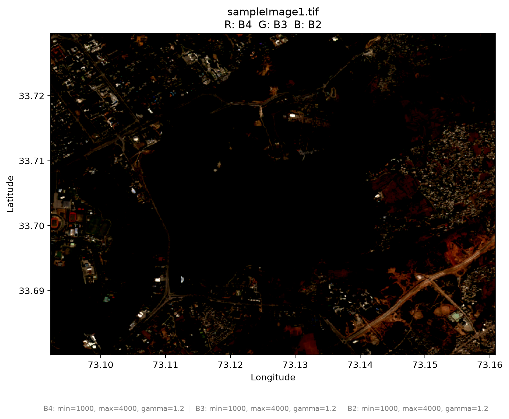
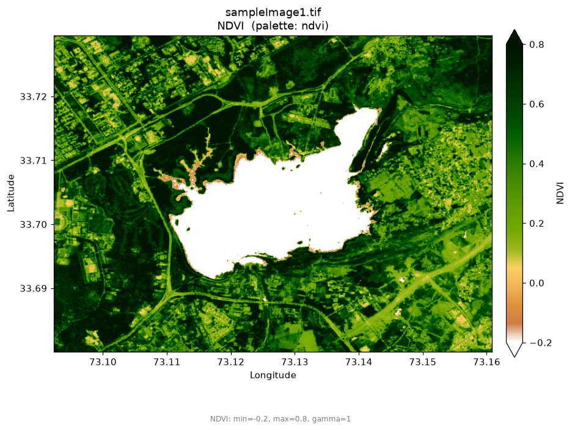
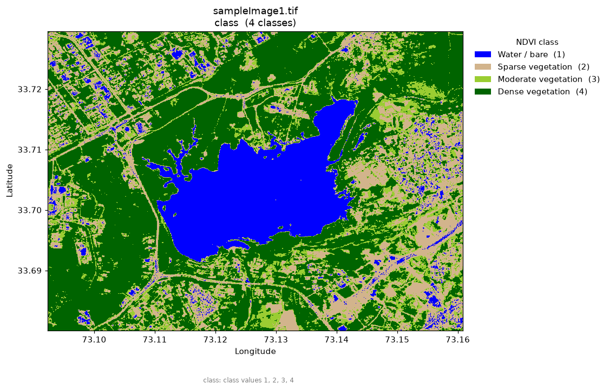

# EarthForge

**Lazy, memory-efficient raster processing and visualization for GeoTIFFs**, with vector support, built on [rasterio](https://rasterio.readthedocs.io/), geopandas and matplotlib.

Select bands, do band math, compute indices with `normalizedDifference()` or `expression()`, reclassify with `where()`, pick and merge classes, cluster and run PCA, mosaic and clip to boundaries from shapefiles, GeoJSON, KML, CSV or Excel, and visualize with `min`/`max`/`gamma`/`palette`. Everything is chainable and runs on files on your own computer, even on modest PCs.

!!! note "Status"
    Early development (version 0.1). Source code: [github.com/msndma2025/EarthForge](https://github.com/msndma2025/EarthForge).

<div class="grid" markdown>

{ width="32%" }
{ width="32%" }
{ width="32%" }

</div>

## Features

| | |
|---|---|
| **Lazy images** | Operations build a recipe. Pixels are read only for previews or when saving, so memory stays small even for huge rasters. [More](performance.md) |
| **Band selection** | `select`, `rename`, `addBands`, `bandNames().size()` [More](raster.md) |
| **Band math** | `add`, `subtract`, `multiply`, `divide`, `pow`, `sqrt`, `log`, …, and the operators `+ - * / **` [More](band-math.md) |
| **Indices** | `normalizedDifference(["B8", "B4"])` [More](band-math.md#normalizeddifferencebandnamesnone-savefalse) |
| **Expressions** | `img.expression("2.5 * (NIR - RED) / (NIR + 6*RED - 7.5*BLUE + 1)", {...})` [More](expressions.md) |
| **Comparisons and logic** | `lt`, `gt`, `eq`, `And`, `Or`, `Not`, and `< > & \| ~` [More](band-math.md#comparisons-and-logic) |
| **Reclassification** | `ndvi.where((ndvi.lt(0.1), 1), (ndvi.gte(0.5), 2))` and `classes.remap({1: 1, 2: 1, 3: 2})` [More](reclassify.md) |
| **Classes** | `classified.eq(3)`, `eq([3, 4])`, `selectClasses([3, 4])`, `mergeClasses([1, 2], into=1)`, `updateMask(...)` [More](reclassify.md#picking-and-merging-classes) |
| **Vectors** | `vector.Open()` for SHP, GeoJSON, KML, KMZ, GeoPackage, Parquet, CSV and Excel; `show()`, `filter()` with `Filter`, `get()`, `map()` for new columns, `join()` / `spatialJoin()` / `merge()`, `visualize()`, `save()`, and drawing on images with `overlay=` [More](vector.md) |
| **Clustering** | `kMeans`, `wekaKMeans`, `wekaCascadeKMeans`, `wekaXMeans`, `miniBatchKMeans`, `bisectingKMeans`, `gaussianMixture`: train on a sample, then `img.cluster(trained)` [More](clustering.md) |
| **PCA** | `pca.PCA(3).train(img)` then `img.pca(model)`; tables too [More](pca.md) |
| **Split and stack** | `img.split(save="bands/")` writes one file per band; `raster.stack([...])` combines bands from many files [More](raster.md#imagesplitsavefalse) |
| **Mosaic** | `raster.mosaic("tiles/")` combines any number of rasters without loading them; `save()` streams block by block with a progress bar [More](mosaic.md) |
| **Clip and extent** | `img.clip(aoi)` crops and masks; `img.geometry().save("extent.geojson")` [More](raster.md#imageclipgeometry-savefalse) |
| **Visualization** | RGB composites, single bands with colorbars, class maps with legends, 16 built-in palettes [More](palettes.md) |
| **Export** | `save()` or `save=True` on any operation writes a compressed GeoTIFF, streamed in blocks with a progress bar; integer types are kept [More](raster.md#imagesave) |

## Install

Requires Python 3.10+.

```bash
pip install pyearthforge                   # once it is published on PyPI
pip install "pyearthforge[jupyter]"        # plus progress-bar widgets for Jupyter
```

Until then, install from GitHub or from a built wheel:

```bash
pip install git+https://github.com/msndma2025/EarthForge.git
pip install pyearthforge-0.1.0-py3-none-any.whl
```

The package is installed and imported as `pyearthforge`: `from pyearthforge import raster, vector, cluster, pca`.

## Quick start

```python
from pyearthforge import raster

img = raster.image("sampleImage1.tif")        # reads metadata only
img.meta()
img.bandNames().size()                        # 26

# True color
img.select("B4", "B3", "B2").visualize(min=1000, max=4000, gamma=1.2)

# NDVI, saved as GeoTIFF
ndvi = img.normalizedDifference(["B8", "B4"], save="ndvi.tif").rename("NDVI")
ndvi.visualize(min=-0.2, max=0.8, palette="ndvi")

# Expression
evi = img.expression(
    "2.5 * ((NIR - RED) / (NIR + 6 * RED - 7.5 * BLUE + 1))",
    {"NIR": img.select("B8") * 0.0001,
     "RED": img.select("B4") * 0.0001,
     "BLUE": img.select("B2") * 0.0001},
).rename("EVI")

# Reclassify NDVI into classes, shown with a legend
classes = ndvi.where(
    (ndvi.lt(0.1), 1),
    (ndvi.gte(0.1).And(ndvi.lt(0.34)), 2),
    (ndvi.gte(0.34).And(ndvi.lt(0.5)), 3),
    (ndvi.gte(0.5), 4),
    otherwise=0,
).rename("class")
classes.visualize(labels={1: "Water / bare", 2: "Sparse", 3: "Moderate", 4: "Dense"},
                  palette=["0000FF", "D2B48C", "9ACD32", "006400"])

# Clip to a boundary and export the image extent
from pyearthforge import vector
aoi = vector.Open("boundary.shp")
ndvi.clip(aoi).visualize(min=-0.2, max=0.8, palette="ndvi")
img.geometry().save("extent.geojson")
```

## Cheat sheet

| Task | Code |
|---|---|
| Open a raster | `img = raster.image("file.tif")` |
| Pick bands | `img.select("B4", "B3", "B2")` |
| Count bands | `img.bandNames().size()` |
| Index | `img.normalizedDifference(["B8", "B4"])` |
| Formula | `img.expression("(NIR - RED) / (NIR + RED)", {"NIR": …, "RED": …})` |
| Condition | `img.gt(0.3).And(img.lt(0.5))` or `(img > 0.3) & (img < 0.5)` |
| Reclassify | `img.where((img.lt(0.1), 1), (img.gte(0.5), 2), otherwise=0)` |
| Recode classes | `classes.remap([1, 2, 3, 4], [1, 1, 2, 2])` |
| Pick a class | `classified.eq(3)` or `classified.selectClasses([3, 4])` |
| Merge classes | `classified.mergeClasses([1, 2], into=1)` |
| Rename bands | `img.rename("NDVI")` |
| Open a vector | `aoi = vector.Open("boundary.shp")` |
| Vector info | `aoi.meta()`, `aoi.columnNames()` |
| Random pixel sample | `img.sample(5000)` or `img.sample(5000, region=aoi)` |
| Your own geometry | `vector.Rectangle(73.11, 33.69, 73.14, 33.71)`, `vector.Polygon([...])`, `vector.Point(x, y).buffer(500)` |
| Cluster an image | `img.cluster(cluster.wekaKMeans(5).train(img))` |
| PCA of an image | `img.pca(pca.PCA(3).train(img))` |
| Plot a vector | `aoi.visualize()` or `aoi.visualize(column="name")` |
| Show records | `stations.show()`, `stations.show(25)`, `stations.show("all")` |
| Filter records | `stations.filter(Filter.eq("district", "North") & Filter.gt("rain_mm", 20))` |
| Column values / one feature | `stations.get("rain_mm")`, `stations.get(0)` |
| Add columns | `stations.map(lambda f: f.set({"rain_cm": f.get("rain_mm") / 10}))` |
| Join by column / by location | `stations.join(table, on="district")`, `stations.spatialJoin(districts)` |
| Vector on an image | `img.visualize(bands=["B4", "B3", "B2"], overlay=aoi)` |
| Clip | `img.clip(aoi)` |
| Mosaic tiles | `raster.mosaic("tiles/*.tif").save("mosaic.tif")` |
| One file per band | `img.split(save="bands/")` |
| Bands from many files | `raster.stack(["B02.tif", "B03.tif", "B04.tif"])` |
| Image extent | `img.bounds(save=True)` or `img.geometry().save("extent.geojson")` |
| Show | `img.visualize(min=…, max=…, palette=…)` |
| Export | `img.save("out.tif")` |

## Using it in Jupyter

After updating the library, **restart the kernel** (Kernel → Restart) and run your cells again.

`%autoreload 2` reloads ordinary code changes, but it can't apply every change to objects you already made. For example, when an attribute becomes a method, an old object raises errors like `TypeError: 'BoundingBox' object is not callable`. A restart always fixes this.

## Building this documentation

```bash
pip install -r requirements-docs.txt
mkdocs serve        # live preview at http://127.0.0.1:8000
mkdocs build        # static site in ./site
```
