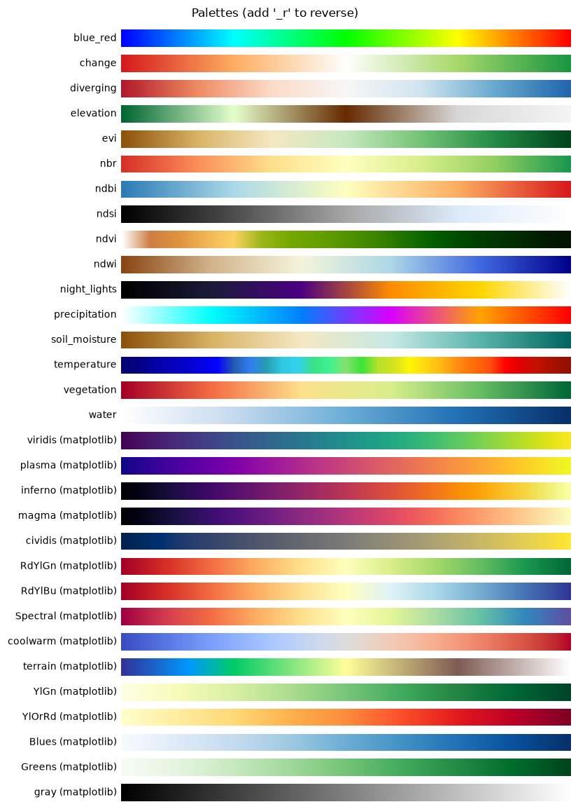

# Palettes

The `palette` argument of [`visualize()`](raster.md#imagevisualize) colors **single-band** images and draws a matching colorbar.

```python
img.normalizedDifference(["B8", "B4"]).visualize(min=-0.2, max=0.8, palette="ndvi")
```



## Ways to specify a palette

| Form | Example | Notes |
|---|---|---|
| Built-in name | `"ndvi"`, `"temperature"` | See the table below. |
| matplotlib colormap | `"viridis"`, `"RdYlGn"`, `"terrain"` | [All matplotlib colormaps](https://matplotlib.org/stable/gallery/color/colormap_reference.html). |
| Reversed | `"ndvi_r"`, `"RdYlGn_r"` | Add `_r` to any name. |
| List of colors | `["0000FF", "FFFFFF", "008000"]` | 2 or more colors, evenly spaced from `min` to `max`. Hex with or without `#`, or names like `"blue"`. |

If a built-in name and a matplotlib name are the same, the built-in palette is used.

## Built-in palettes

| Name | Good for | Low → high |
|---|---|---|
| `ndvi` | NDVI | white/bare → brown → green → dark green |
| `evi` | EVI, vegetation vigor | brown → beige → green |
| `vegetation` | Any vegetation index | red → yellow → green |
| `ndwi` | NDWI / water indices | brown (dry) → beige → blue (water) |
| `water` | Water depth, MNDWI, turbidity | white → dark blue |
| `precipitation` | Rainfall | white → cyan → blue → purple → orange → red |
| `soil_moisture` | Soil moisture | brown (dry) → teal (wet) |
| `ndbi` | Built-up index | blue → yellow → red (urban) |
| `nbr` | Burn ratio | red (burned) → yellow → green (healthy) |
| `ndsi` | Snow index | black → gray → white (snow) |
| `elevation` | DEMs | green (low) → light green → brown → gray → white (peaks) |
| `temperature` | Land surface temperature | dark blue → cyan → green → yellow → red (MODIS LST palette) |
| `night_lights` | Night-time lights (VIIRS) | black → purple → orange → white |
| `diverging` | Anomalies centered on 0 | red → white → blue |
| `change` | Change detection (loss/gain) | red (loss) → white → green (gain) |
| `blue_red` | General purpose ("rainbow") | blue → cyan → green → yellow → red |

## Functions

### `raster.palettes()`
Returns the built-in palette names as a sorted list.

```python
raster.palettes()
# ['blue_red', 'change', 'diverging', 'elevation', 'evi', 'nbr', 'ndbi', 'ndsi', 'ndvi', 'ndwi',
#  'night_lights', 'precipitation', 'soil_moisture', 'temperature', 'vegetation', 'water']
```

### `raster.showPalettes(names=None, save_chart=False, dpi=200)`
Shows a color strip for each palette, like the image above.

| Parameter | Type | Default | Description |
|---|---|---|---|
| `names` | list of `str` | all built-ins + 15 popular matplotlib colormaps | Palettes to show. |
| `save_chart` | `bool` | `False` | Also saves `palettes_<epoch>.png`. |
| `dpi` | `int` | `200` | Resolution of the saved PNG. |

```python
raster.showPalettes()
raster.showPalettes(["ndvi", "ndvi_r", "viridis", ["red", "yellow", "green"]])
```

### `raster.PALETTES`
The `dict` that holds the built-in palettes (name → list of hex colors). To add your own palette for the session:

```python
raster.PALETTES["my_palette"] = ["000000", "FF0000", "FFFF00"]
img.select("B8").visualize(palette="my_palette")
```

## Legends for class maps

For categorical images, such as the output of [`where()`](reclassify.md), pass `labels` to get one flat color per class and a legend:

```python
classes.visualize(labels={1: "Water", 2: "Sparse", 3: "Moderate", 4: "Dense"},
                  palette=["0000FF", "D2B48C", "9ACD32", "006400"])
classes.visualize(labels={1: "Water", 2: "Land"})                 # colors from "tab10"
classes.visualize(labels={1: "Low", 2: "Mid", 3: "High"}, palette="YlGn")   # sampled evenly
```

With `labels`, `palette` can be a list with one color per class, or a palette name. Qualitative matplotlib maps (`tab10`, `Set1`, `Paired`, …) are used color by color. Other palettes are sampled evenly from end to end. See [Showing class maps](reclassify.md#showing-class-maps).

## Colorbar options

| `visualize()` argument | Default | Description |
|---|---|---|
| `colorbar` | `True` | Show or hide the colorbar. |
| `colorbar_label` | band name | Colorbar title. |
| `colorbar_orientation` | `"vertical"` | `"vertical"` puts it to the right of the map, `"horizontal"` below it. |

The colorbar shows real pixel values from `min` to `max`. The arrows at each end mean values outside that range are clipped to the end colors.
