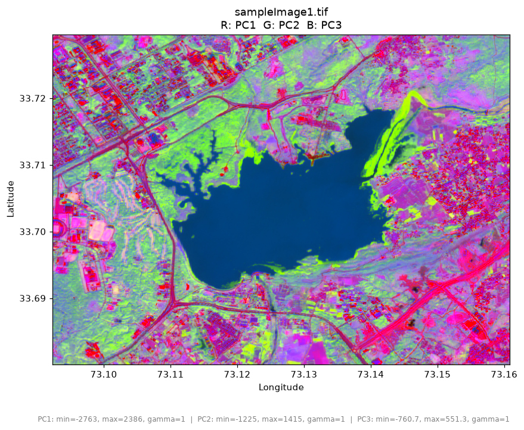

# PCA (principal component analysis)

PCA turns many correlated bands or columns into a few uncorrelated **principal components**. PC1 holds the most variation, PC2 the most of what is left, and so on, so the first few components usually summarize the data. Use it to:

- **compress many bands** into 2–3 that keep almost all the information,
- **make contrast-rich composites** (PC1, PC2, PC3 as RGB),
- **reduce inputs** before [clustering](clustering.md).

```python
from earthforge import raster, pca

img = raster.image("sampleImage1.tif").select("B2", "B3", "B4", "B8", "B11", "B12")

model = pca.PCA(3).train(img, numPixels=10000)    # learn the components from a sample
model.info()                                      # explained variance and loadings

pcs = img.pca(model)                              # lazy image: bands PC1, PC2, PC3
pcs.visualize(bands=["PC1", "PC2", "PC3"])
pcs.save("pca.tif")                               # streamed block by block
```

{ width="75%" }

```
========================================================
 PCA of      : ['B2', 'B3', 'B4', 'B8', 'B11', 'B12']
 Samples     : 10000   standardized: False
   PC1    75.56 %   cumulative  75.56 %
   PC2    19.45 %   cumulative  95.02 %
   PC3     4.23 %   cumulative  99.25 %
 Loadings:
          PC1    PC2    PC3
   B2   0.149 -0.270 -0.402
   B3   0.193 -0.268 -0.441
   B4   0.268 -0.419 -0.406
   B8   0.567  0.734 -0.335
   B11  0.569 -0.065  0.516
   B12  0.473 -0.371  0.318
========================================================
```

Three components keep **99.25%** of the variation of six bands. PC1 is overall brightness (all loadings positive); PC2 contrasts NIR (B8, positive) with visible and SWIR (negative), much like a vegetation index.

---

## `pca.PCA(nComponents=None, standardize=False)`

Creates a PCA, ready to be trained.

| Parameter | Type | Default | Description |
|---|---|---|---|
| `nComponents` | `int` | all | Number of components to keep. Default: as many as there are inputs. |
| `standardize` | `bool` | `False` | Scale every input to unit variance first (correlation PCA). Use it when inputs have **different units or ranges**, e.g. NDVI, elevation and rainfall. Leave it off for bands of one sensor. |

```python
pca.PCA(3)
pca.PCA(standardize=True)                     # all components, correlation PCA
```

**Raises:** `ValueError` if `nComponents` is not a positive whole number.

---

## `PCA.train(data, inputProperties=None, numPixels=10000, seed=0, region=None)`

Learns the components from an image sample or a dataset's columns.

| Parameter | Type | Default | Description |
|---|---|---|---|
| `data` | `Image` or `Vector` | – | **Image:** `numPixels` random pixels are sampled (block by block). **Vector:** its numeric columns are used. |
| `inputProperties` | list of `str` | all | The bands or columns to use. |
| `numPixels` | `int` | `10000` | Pixels to sample from an image. |
| `seed` | `int` | `0` | Random seed for the sample. |
| `region` | `Vector` | – | Learn the components only from pixels (or rows) inside these shapes. The full `numPixels` are drawn inside the region. |

**Returns:** a `TrainedPCA`.

**Raises:** `ValueError` if `nComponents` is larger than the number of inputs, there are too few valid samples, or the region doesn't overlap the image; `TypeError` if `region` isn't a `Vector`.

```python
model = pca.PCA(3).train(img)
model = pca.PCA(2).train(img, inputProperties=["B4", "B8", "B11", "B12"], numPixels=20000)
```

### Training inside a region

Pass `region=` to learn the components from your study area only, for example a district, a field or a watershed. The model can then be applied to the region or to the whole image.

```python
from earthforge import vector

districts = vector.Open("sample_data/districts.geojson")
central = districts.filter(vector.Filter.eq("district", "Central"))

model = pca.PCA(2).train(img, region=central)        # 10,000 pixels, all inside Central
model.explainedVariance()                            # [0.909, 0.080]: one dominant component here
img.clip(central).pca(model).visualize(bands="PC1")  # components of the region only
img.pca(model)                                       # or of the whole image

local = img.pca(2, region=central)                   # train inside the region and apply, in one step
```

### Sampling with your own geometry

The region can be any geometry you define yourself. No file is needed (see [Creating your own geometries](vector.md#creating-your-own-geometries)):

```python
from earthforge import vector

# a rectangle from coordinates (longitude, latitude)
box = vector.Rectangle(73.11, 33.69, 73.14, 33.71)
model = pca.PCA(3).train(img, region=box)

# a polygon from its corners
lake = vector.Polygon([(73.110, 33.690), (73.145, 33.692), (73.148, 33.716), (73.118, 33.712)])
model = pca.PCA(3).train(img, region=lake)
model.explainedVariance()                       # [0.887, 0.097, 0.013]

# a circle of 500 m around a point
circle = vector.Point(73.125, 33.700).buffer(500)
pcs = img.pca(3, region=circle)                 # train inside the circle and apply, in one step

# a shape drawn on geojson.io (paste the GeoJSON), or WKT text
drawn = vector.fromGeometry({"type": "Polygon", "coordinates": [[[73.11, 33.69], [73.14, 33.69],
                                                                 [73.14, 33.71], [73.11, 33.69]]]})
model = pca.PCA(2).train(img, region=drawn)

# coordinates in another CRS (UTM metres): reprojected automatically
box_utm = vector.Rectangle(323500, 3729500, 326500, 3731500, crs="EPSG:32643")
model = pca.PCA(2).train(img, region=box_utm)

# several areas at once
from shapely.geometry import box as shape_box
areas = vector.fromGeometry([shape_box(73.10, 33.70, 73.11, 33.71), shape_box(73.15, 33.68, 73.16, 33.69)])
model = pca.PCA(3).train(img, region=areas)     # pixels from both areas
```

You can also sample first and keep the sample, for example to inspect or save it, then train on it:

```python
samples = img.sample(10000, region=lake)        # 10,000 pixels, all inside the polygon
samples.show(5)
samples.save("lake_pixels.csv")
model = pca.PCA(3).train(samples)
```

All `numPixels` are drawn inside the geometry, as long as it covers that many pixels.

The components describe the variation **inside** the region, so they differ from components learned on the whole image. For the six bands above, PC1 explains 76% of the variation of the whole scene but 91% within the Central district, which is mostly lake and shore.

The results match scikit-learn's PCA on the same sample.

---

## The trained model

| Member | Returns |
|---|---|
| `model.nComponents` | Number of components. |
| `model.schema()` | The bands or columns it was trained on. |
| `model.componentNames()` | Output names: `['PC1', 'PC2', ...]`. |
| `model.explainedVariance()` | Share of the total variance each component explains (0–1). |
| `model.loadings()` | Table of how much each input contributes to each component. |
| `model.info()` | Prints explained variance and loadings; returns a dict. |

```python
model.nComponents                  # 3
model.schema()                     # ['B2', 'B3', 'B4', 'B8', 'B11', 'B12']
model.componentNames()             # ['PC1', 'PC2', 'PC3']
model.explainedVariance()          # [0.7556, 0.1945, 0.0423]
sum(model.explainedVariance())     # 0.9925: share kept by the 3 components
model.loadings()                   # inputs x components
model.info()
```

---

## Applying: `img.pca()` and `vector.pca()`

### `Image.pca(model, numPixels=10000, standardize=False, seed=0, region=None)`

Transforms the image into its principal components: a **lazy** image with float32 bands `PC1`, `PC2`, ... Give a trained model, or a number of components to train one on this image right away. When training this way, `region=` limits the training pixels to a geometry; the whole image is still transformed.

```python
pcs = img.pca(model)                        # with a trained model
quick = img.pca(3)                          # train and apply in one step
all_pcs = img.pca(None, standardize=True)   # all components, correlation PCA

pcs.select("PC1").visualize(palette="gray")
pcs.select("PC1", "PC2").save("pc12.tif")
```

The image must have the bands the model was trained on. Pixels with NoData in any input stay NoData. You can apply a model trained on one image to another image with the same bands, e.g. another date.

### `Vector.pca(model, columns=None, standardize=False)`

Adds columns `PC1`, `PC2`, ... to a table or vector dataset.

```python
from earthforge import vector

stations = vector.Open("sample_data/stations.csv")
with_pcs = stations.pca(2, columns=["ndvi", "elevation_m", "rain_mm", "temp_c"], standardize=True)
with_pcs.show(5, columns=["station_id", "PC1", "PC2"])

# or with a model you keep
model = pca.PCA(2, standardize=True).train(stations, inputProperties=["ndvi", "elevation_m", "temp_c"])
stations.pca(model)
```

Rows with an empty value in any input column get empty components.

---

## PCA, then clustering

Cluster on the first few components instead of many raw bands:

```python
from earthforge import cluster

pcs = img.pca(pca.PCA(3).train(img))
trained = cluster.kMeans(5).train(pcs, numPixels=5000)
pcs.cluster(trained).visualize(labels={i: f"Cluster {i}" for i in range(5)})
```

## Memory and speed

Training reads only a sample, and on large images only the tiles that hold sampled pixels: training on 10,000 pixels of a 30,000 × 30,000 raster (2.9 GB) took 2.8 s. Applying works block by block. On an 8000 × 8000 × 4-band raster, saving 3 components took 22 s with 1 worker (peak 79 MB) and 15 s with the default workers (peak 575 MB). All components of a block are computed together, so the inputs are read once.
