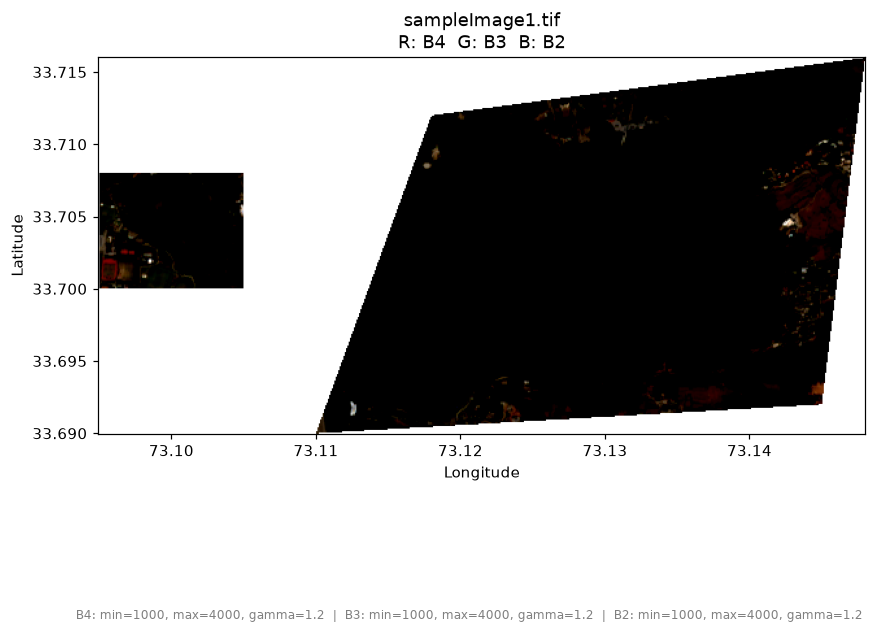
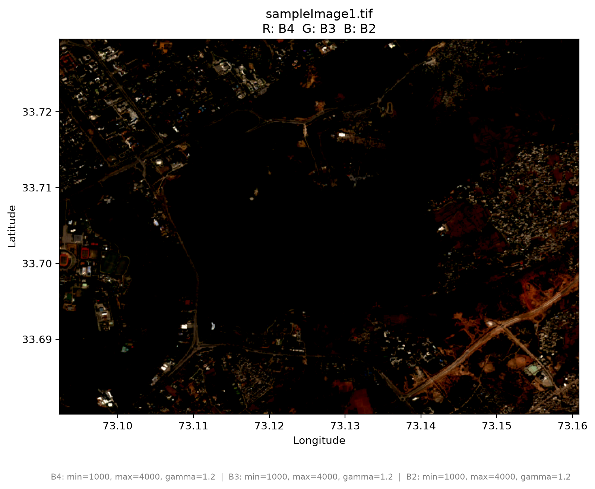
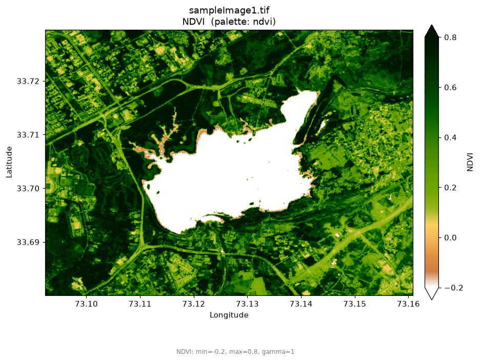
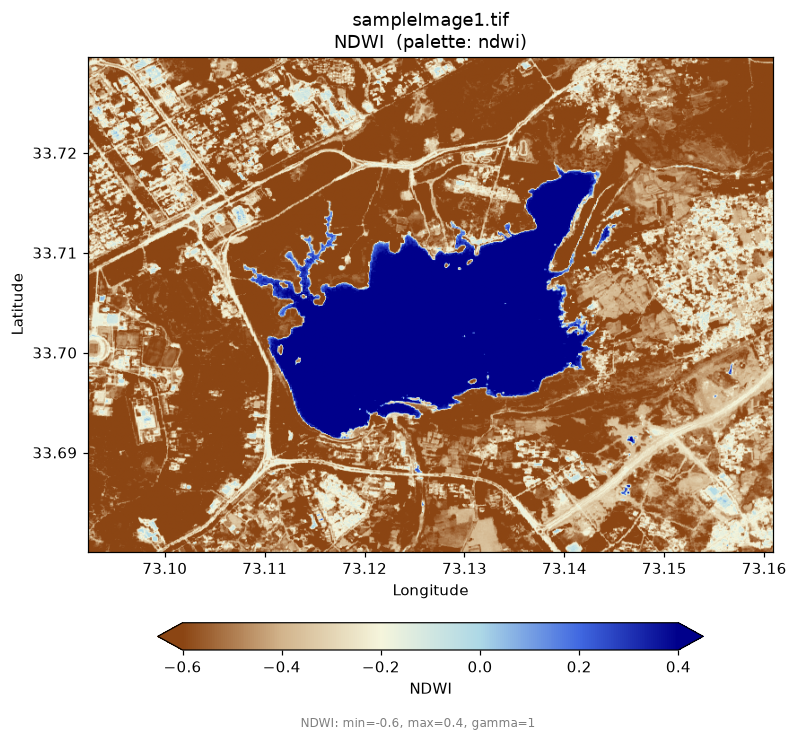

# `raster`: loading, selecting, saving and visualizing images

```python
from pyearthforge import raster
```

Related pages: [Band math](band-math.md) · [Expressions](expressions.md) · [Reclassify](reclassify.md) · [Mosaic](mosaic.md) · [Vector](vector.md) · [Palettes](palettes.md) · [Memory and performance](performance.md) · [Errors](errors.md)

- [How images work (lazy evaluation)](#how-images-work-lazy-evaluation)
- [`raster.image(path)`](#rasterimagepath)
- [`Image` attributes](#image-attributes)
- [`Image.bandNames()`](#imagebandnames)
- [`Image.select(*bands)`](#imageselectbands)
- [`Image.rename(*names)`](#imagerenamenames)
- [`Image.addBands(other)`](#imageaddbandsother)
- [`Image.split(save=False)`](#imagesplitsavefalse)
- [`raster.stack(images, names=None, save=False)`](#rasterstackimages-namesnone-savefalse)
- [`Image.bounds(save=False)`](#imageboundssavefalse)
- [`Image.geometry()`](#imagegeometry)
- [`Image.clip(geometry, save=False)`](#imageclipgeometry-savefalse)
- [`Image.updateMask(mask, save=False)`](#imageupdatemaskmask-savefalse)
- [`Image.sample()`](#imagesample)
- [`Image.cluster()` and `Image.pca()`](#imagecluster-and-imagepca)
- [`Image.meta()`](#imagemeta)
- [`Image.save()`](#imagesave)
- [`Image.visualize(...)`](#imagevisualize)
- [Specifying bands](#specifying-bands)
- [Limitations](#limitations)

---

## How images work (lazy evaluation)

An `Image` is a **recipe**, not pixels in memory.

| Operation | Pixels read |
|---|---|
| `raster.image()`, `raster.mosaic()`, `raster.stack()`, `split()`, `select()`, `rename()`, `addBands()`, band math, comparisons, `normalizedDifference()`, `expression()`, `where()`, `remap()`, `clip()`, `updateMask()`, `cluster()`, `pca()`, `geometry()`, `bounds()`, `bandNames()`, `meta()`, `print(img)` | None |
| `sample()` | Only the blocks that contain sampled pixels |
| `visualize()` | A downsampled preview (longest side ≤ `max_size`, default 1500 px) |
| `save()` | The full image, streamed in 1024 × 1024 blocks |
| `img.data` | The full image, all at once |

You can chain as many operations as you like at no cost. Pixels are read only at the end, and only as much as needed. See [Memory and performance](performance.md).

---

## `raster.image(path)`

Opens a raster and returns an [`Image`](#image-attributes). Only the metadata is read.

| Parameter | Type | Description |
|---|---|---|
| `path` | `str` or `Path` | Path to a GeoTIFF, or any format rasterio can read. Relative paths are resolved against the current working directory when the image is created. |

**Returns:** `Image`

**Raises:**
- `RasterNotFoundError` if `path` does not exist or is not a file.
- `RasterReadError` if the file exists but rasterio cannot open it.

```python
img = raster.image("sampleImage1.tif")
print(img)
# <Image sampleImage1.tif bands=['B1', 'B2', ..., 'MSK_CLASSI_SNOW_ICE'] shape=(26, 551, 763)>
```

The file must stay in place while the `Image` is in use, because pixels are read from it on demand.

---

## `Image` attributes

| Attribute | Type | Description |
|---|---|---|
| `path` | `str` | The path the image was loaded from. Derived images keep the original path. |
| `res` | `tuple[float, float]` | Pixel size `(x, y)` in CRS units. |
| `data` | `numpy.ndarray` (float32) | All pixels at full resolution, shape `(bands, rows, cols)`. **Computed each time it is accessed.** Store it in a variable if you need it more than once. NoData pixels are `NaN`. |

```python
img.path                        # 'sampleImage1.tif'
img.res                         # (8.983152841195215e-05, 8.983152841195215e-05)

arr = img.select("B8").data     # compute once, keep the array
arr.shape                       # (1, 551, 763)
float(np.nanmean(arr))          # average NIR value
```

The extent is available as [`img.bounds()`](#imageboundssavefalse).

---

## `Image.bandNames()`

Returns the band names in band order, as a `BandList`.

A `BandList` is an ordinary Python `list` (indexing, `len()`, `in` and loops all work) with two extras:

| Method | Returns |
|---|---|
| `.size()` | Number of bands (`int`) |
| `.get(i)` | Band name at 0-based index `i` |

```python
img.bandNames()              # ['B1', 'B2', 'B3', 'B4', ...]
img.bandNames().size()       # 26
img.bandNames().get(0)       # 'B1'
"B8" in img.bandNames()      # True
```

Names come from the band descriptions in the GeoTIFF. A band with no description is named `B<n>`, where `n` is its 1-based band number.

---

## `Image.select(*bands)`

Selects bands, returning a **new** `Image` with only those bands, in the order given. No pixels are read or copied.

| Parameter | Type | Description |
|---|---|---|
| `*bands` | `str`, `int`, or one `list`/`tuple` of them | Band names or 1-based band numbers. See [Specifying bands](#specifying-bands). |

**Raises:** `ValueError` if no bands are given, or a band does not exist.

```python
nir = img.select("B8")
rgb = img.select("B4", "B3", "B2")
rgb = img.select(["B4", "B3", "B2"])
fcc = img.select([8, 4, 3])
```

---

## `Image.rename(*names)`

Renames the bands, returning a **new** `Image`.

| Parameter | Type | Description |
|---|---|---|
| `*names` | `str`, or one `list` of `str` | One name per band. |

**Raises:** `ValueError` if the number of names doesn't match the number of bands.

```python
ndvi = img.normalizedDifference(["B8", "B4"]).rename("NDVI")
rg = img.select("B4", "B3").rename(["red", "green"])
```

---

## `Image.addBands(other)`

Adds the bands of `other` after this image's bands, returning a **new** `Image`.

**Raises:**
- `TypeError` if `other` is not an `Image`.
- `ValueError` if the images are on different pixel grids, or if band names would be duplicated. Use `rename()` first.

```python
ndvi = img.normalizedDifference(["B8", "B4"]).rename("NDVI")
stack = img.select("B4", "B8").addBands(ndvi)
stack.bandNames()          # ['B4', 'B8', 'NDVI']
stack.save("stack.tif")
```

To combine more than two images, or images on different grids, use [`raster.stack()`](#rasterstackimages-namesnone-savefalse).

---

## `Image.split(save=False)`

Splits the image into single-band images, one per band, in band order. No pixels are read unless you save.

| Parameter | Type | Default | Description |
|---|---|---|---|
| `save` | `bool` or `str` | `False` | `True` also saves each band as its own GeoTIFF, named `<image>_<band>.tif`, in the current folder. A string saves them into that folder, which is created if needed. |

**Returns:** `list` of `Image`, one per band.

**Raises:** `TypeError` if `save` is not `True`, `False` or a folder path.

```python
bands = img.split()
bands[3].bandNames()                        # ['B4']
for band in img.select("B2", "B3", "B4").split():
    band.visualize(palette="gray")

img.select("B2", "B3", "B4", "B8").split(save="bands/")
# bands/sampleImage1_B2.tif, bands/sampleImage1_B3.tif, bands/sampleImage1_B4.tif, bands/sampleImage1_B8.tif
```

Saved files keep the integer type of the source when it has one, and each file stores its band name.

---

## `raster.stack(images, names=None, save=False)`

Stacks the bands of several images into **one multi-band image**, for example single-band files (one GeoTIFF per band) or a mix of bands and computed indices. Nothing is read until you visualize or save.

| Parameter | Type | Default | Description |
|---|---|---|---|
| `images` | list, folder, or pattern | – | A list of `Image`s and/or file paths; a folder (all `.tif`/`.tiff` files, in name order); or a glob pattern such as `"bands/*_B0[2348].tif"`. All must have the same CRS. |
| `names` | list of `str` | – | New band names, one per band of the result. |
| `save` | `bool` or `str` | `False` | `True` saves `stack_stack_<epoch>.tif`; a string saves to that path. |

**Returns:** `Image` with the bands of all inputs, in order.

**Raises:** `ValueError` if no images are given, the CRSs differ, or `names` has the wrong length.

```python
s = raster.stack(["B02.tif", "B03.tif", "B04.tif", "B08.tif"],
                 names=["blue", "green", "red", "nir"])
s = raster.stack("bands/")                                    # every .tif in a folder
s = raster.stack([img.select("B8"), ndvi.rename("NDVI")], save="nir_ndvi.tif")
```

- **The first image sets the grid** (extent and pixel size). Images on a different grid are resampled to it with nearest neighbour; areas they don't cover become NoData. For example, Sentinel-2 20 m bands stacked after a 10 m band are resampled to 10 m.
- **Band names:** the original names are kept. Where names repeat, which is common with single-band files whose band is always called `B1`, they are prefixed with the file name, e.g. `T43_B04_B1`. Pass `names=` to choose your own.
- **Split and stack are opposites:** `raster.stack(img.split())` gives back the same image.

---

## `Image.bounds(save=False)`

Returns the image's bounding box. It can also save the box as a GeoJSON rectangle.

| Parameter | Type | Default | Description |
|---|---|---|---|
| `save` | `bool` or `str` | `False` | `True` saves the box to `<image>_bounds_<epoch>.geojson` in the current folder. A string saves to that path: GeoJSON for `.geojson`/`.json`, and other vector formats such as `.shp` or `.kml` also work. |

**Returns:** `BoundingBox(left, bottom, right, top)` in the image's CRS. Read the values as `b.left`, `b.bottom`, `b.right`, `b.top`.

**Raises:** `TypeError` if `save` is not `True`, `False` or a file path.

```python
extent = evi.bounds()
# BoundingBox(left=73.0923..., bottom=33.6800..., right=73.1608..., top=33.7295...)
extent.left, extent.top

extent = evi.bounds(save=True)                    # also writes sampleImage1_bounds_1795578943.geojson
extent = evi.bounds(save="evi_extent.geojson")    # choose the file name
```

GeoJSON is always written in EPSG:4326 (longitude/latitude), so an image in UTM gets a GeoJSON in degrees. After `clip()`, the bounds are those of the clipped image.

`bounds()` is always the axis-aligned rectangle. [`geometry()`](#imagegeometry) follows the image's actual corners and returns a `Vector` you can inspect further. For normal north-up images, both give the same rectangle.

---

## `Image.geometry()`

Returns the image's extent (footprint) as a [`Vector`](vector.md) containing one polygon, in the image's CRS. Print it, inspect it, or export it.

```python
extent = img.geometry()
print(extent)
# <Vector sampleImage1 (extent) | 1 feature | Polygon | EPSG:4326>
#            name                                                     geometry
# 0  sampleImage1  POLYGON ((73.09232 33.72958, 73.16086 33.72958, 73.16086 ...

extent.meta()
extent.toGeoJSON()                      # GeoJSON dict
extent.save("extent.geojson")           # or .shp, .kml, .gpkg, .csv, ...
```

The polygon follows the image's actual corners, so it is correct for rotated images too. After `clip()`, it is the extent of the clipped image.

---

## `Image.clip(geometry, save=False)`

Clips the image to a [vector](vector.md):
1. **Crops** the image to the vector's bounding box. The result is smaller, faster, and uses less memory.
2. **Masks** every pixel outside the shapes, so those pixels become NoData (NaN).

The vector is reprojected to the image's CRS automatically. A pixel counts as inside when its **center** is inside a shape, which is the same rule GDAL and `rasterio.mask` use.

| Parameter | Type | Default | Description |
|---|---|---|---|
| `geometry` | `Vector` | – | e.g. `vector.Open("boundary.shp")`, or another image's `.geometry()`. All features are used. |
| `save` | `bool` or `str` | `False` | `True` saves `<image>_clip_<epoch>.tif`; a string saves to that path. |

**Returns:** `Image` (lazy, like everything else)

**Raises:**
- `TypeError` if `geometry` is not a `Vector`.
- `ValueError` if the vector is a table without geometries, has no CRS, or doesn't overlap the image.

```python
from pyearthforge import raster, vector

img = raster.image("sampleImage1.tif")
aoi = vector.Open("boundary.shp")

clipped = img.clip(aoi)
clipped.select("B4", "B3", "B2").visualize(min=1000, max=4000, gamma=1.2)

# Clip any result, and save in one step
img.normalizedDifference(["B8", "B4"]).rename("NDVI").clip(aoi, save="ndvi_aoi.tif")
```

{ width="70%" }

A clipped image has a different size from the original, so it can only be combined in band math with images clipped the same way.

---

## `Image.updateMask(mask, save=False)`

Masks the image: wherever `mask` is 0 or NoData, pixels become NoData. Any non-zero value keeps the pixel. Use it to keep only some classes, or only pixels that meet a condition.

| Parameter | Type | Default | Description |
|---|---|---|---|
| `mask` | `Image` | – | 1 band (applied to every band) or the same number of bands as the image. |
| `save` | `bool` or `str` | `False` | `True` saves `<image>_updateMask_<epoch>.tif`; a string saves to that path. |

```python
# True color, only where the class map says "dense vegetation" (class 4)
img.select("B4", "B3", "B2").updateMask(classified.eq(4)).visualize(min=1000, max=4000)

# NDVI without water
ndvi.updateMask(ndvi.gt(0))
```

---

## `Image.sample()`

```python
Image.sample(numPixels=5000, seed=0, geometries=True, progress=True, region=None)
```

Samples random pixels and returns their band values as a [vector dataset](vector.md), one row per pixel. It is used to train [clusterers](clustering.md) and [PCA](pca.md), and it's handy for statistics, charts or exporting training data.

| Parameter | Type | Default | Description |
|---|---|---|---|
| `numPixels` | `int` | `5000` | Number of random pixels. |
| `seed` | `int` | `0` | Random seed: the same seed gives the same pixels. |
| `geometries` | `bool` | `True` | Add a point at each pixel centre. `False` gives a plain table. |
| `progress` | `bool` | `True` | Show a progress bar on large images. |
| `region` | `Vector` | – | Only sample pixels whose centre is inside these shapes. Reprojected to the image's CRS automatically. The full `numPixels` are drawn inside the region when it has that many pixels. |

**Returns:** `Vector` with one column per band.

**Raises:** `ValueError` if `numPixels` is not a positive whole number, or the region doesn't overlap the image; `TypeError` if `region` isn't a `Vector`.

Pixels with NoData in any band are left out, so the result can have fewer rows than requested.

```python
samples = img.select("B2", "B3", "B4", "B8").sample(2000)
samples.show(5)
samples.data.describe()                          # statistics with pandas
samples.save("training_pixels.csv")

ndvi_samples = img.normalizedDifference(["B8", "B4"]).rename("NDVI").sample(1000)

aoi = vector.Open("boundary.shp")
inside = img.sample(1000, region=aoi)            # 1000 pixels, all inside the boundary

# or a geometry you define yourself (see vector: Creating your own geometries)
img.sample(1000, region=vector.Rectangle(73.11, 33.69, 73.14, 33.71))
img.sample(300, region=vector.Point(73.125, 33.700).buffer(500))     # within 500 m of a point
```

**What is read.** Sampling reads as little as possible:

- **Samples spread thinly over a large image** (e.g. 5,000 pixels on a huge mosaic): only the small 256 × 256 tiles that hold a sample are read, and only the sampled pixels are computed. Memory stays at a few MB.
- **Dense samples** (many samples per block, or a small image): whole 1024 × 1024 blocks are read, which is faster when most of the image would be touched anyway.

The library chooses automatically, and the result is identical either way. On a 30,000 × 30,000 raster (2.9 GB), 2,000 samples took 2.2 s with 1 MB of memory, against 3.1–5.6 s and about 110 MB when reading whole blocks. On images too big for the computer's file cache, the difference is much larger.

---

## `Image.cluster()` and `Image.pca()`

| Method | Returns |
|---|---|
| `img.cluster(clusterer, outputName="cluster", numPixels=5000, seed=0, region=None)` | A lazy single-band image of cluster numbers (0, 1, 2, ...). Give a trained clusterer, or an untrained one to train it on this image (inside `region` if given). Saved as uint8 with NoData = 255. |
| `img.pca(model, numPixels=10000, standardize=False, seed=0, region=None)` | A lazy image with bands `PC1`, `PC2`, ..., from a trained PCA or a number of components (trained inside `region` if given). |

```python
from pyearthforge import cluster, pca

trained = cluster.wekaKMeans(5).train(img, numPixels=5000)
img.cluster(trained).visualize(labels={i: f"Cluster {i}" for i in range(5)})
img.cluster(cluster.wekaKMeans(5), region=aoi)        # train inside aoi and apply, in one step

pcs = img.pca(pca.PCA(3).train(img))
pcs.visualize(bands=["PC1", "PC2", "PC3"])
img.pca(3, region=aoi)                                # same idea for PCA
```

See [Clustering](clustering.md) and [PCA](pca.md) for all methods and options.

---

## `Image.meta()`

Prints a summary of the image and returns its metadata. Reads no pixels.

**Returns:** `dict` with `driver`, `dtype`, `nodata`, `width`, `height`, `count`, `crs`, `transform`, `bandNames`.

For images produced by band math, the header says `(computed)`, `dtype` is `float32`, and `nodata` is `nan`. That matches what `save()` writes.

```python
img.select("B4", "B3", "B2").meta()
```
```
=============================================
 Metadata for: sampleImage1.tif
=============================================
 Driver     : GTiff
 Width      : 763 px
 Height     : 551 px
 Bands      : 3
 Band names : ['B4', 'B3', 'B2']
 Data type  : float64
 NoData     : None
 CRS        : EPSG:4326
 Resolution : (8.983152841195215e-05, 8.983152841195215e-05)
 Bounds     : BoundingBox(left=73.0923..., bottom=33.6800..., right=73.1608..., top=33.7295...)
 Transform  :
| 0.00, 0.00, 73.09|
| 0.00,-0.00, 33.73|
| 0.00, 0.00, 1.00|
=============================================
```

In Jupyter, write `img.meta()`, not `print(img.meta())`. Otherwise the returned dict is printed as well.

---

## `Image.save()`

```python
Image.save(path=None, compress="deflate", dtype=None, nodata=None, progress=True, workers=None)
```

Writes the image to a GeoTIFF. The image is computed and written in **1024 × 1024 pixel blocks**, so memory use depends on the block size, not on the image size. On a computer with several CPU cores, blocks are computed in parallel. A progress bar shows how far it is: a widget in Jupyter, a text bar in a terminal.

| Parameter | Type | Default | Description |
|---|---|---|---|
| `path` | `str` | auto | Output file. The default is `<image stem>_<band names>_<unix epoch>.tif` in the current working directory. |
| `compress` | `str` or `None` | `"deflate"` | `"deflate"` (small, widely supported), `"zstd"` (a little faster), `"lzw"` (faster, larger file), or `None` (fastest, largest file). |
| `dtype` | `str` | auto | Data type of the file, e.g. `"uint16"`, `"int16"`, `"float32"`. **Auto:** the source's integer type when pixel values pass through unchanged (`select`, `clip`, `updateMask`, `"first"`/`"last"`/`"min"`/`"max"` mosaics), otherwise `float32`. Computed values saved to an integer type are rounded and clipped to the type's range. |
| `nodata` | number | auto | Value written for NoData pixels. **Auto:** NaN for float types; for integer types the source's NoData value, or `0`. |
| `progress` | `bool` | `True` | Show a progress bar. |
| `workers` | `int` | auto | How many blocks are computed at the same time. **Auto:** one per CPU core, up to 8 (`raster.MAX_WORKERS`), and fewer if the blocks in progress would need more than about a quarter of the free memory. `1` processes one block at a time. See [Memory and performance](performance.md#many-cores-and-lots-of-ram). |

**Returns:** the absolute path of the written file (`str`).

**Raises:** `ValueError` if `path` is one of the files the image reads from, `dtype` is unknown, `nodata` doesn't fit in an integer `dtype`, or `workers` is less than 1.

Output format:
- band names stored as band descriptions, so `raster.image()` reads them back
- tiled 256×256 (for images at least 256 px in each direction), with a predictor suited to the data type and multi-threaded compression
- BigTIFF used automatically when the file would exceed 4 GB

```python
img.normalizedDifference(["B8", "B4"]).rename("NDVI").save("ndvi.tif")      # float32
img.select("B4", "B3", "B2").save()                 # keeps the file's type if it is an integer type
(img * 0.0001).save("reflectance.tif", compress="zstd")
classified.save("classes.tif", dtype="uint8", nodata=255)                    # small class map
```

Band-math methods also accept a `save` argument that calls `save()` for you. See [Band math](band-math.md#the-save-argument).

---

## `Image.visualize(...)`

```python
Image.visualize(bands=None, min=None, max=None, gamma=1.0, palette=None,
                colorbar=True, colorbar_label=None, colorbar_orientation="vertical",
                labels=None, overlay=None, overlay_color="red", max_size=1500,
                save_chart=False, dpi=200)
```

Displays the image as a map chart with matplotlib. Each band is stretched linearly from `min` to `max`, then gamma correction is applied. It can show an RGB composite (3 bands), a single band with a palette and colorbar, or a class map with a legend.

Only a **downsampled preview** is read: its longest side is at most `max_size` pixels. The axes show map coordinates (latitude/longitude for geographic CRSs, otherwise X/Y), and the stretch values are printed below the chart.

| Parameter | Type | Default | Description |
|---|---|---|---|
| `bands` | `str`, `int`, `list`, or `Image` | first 3 bands (first band if fewer than 3) | 1 band for a single-band view, 3 bands for an RGB composite in `[red, green, blue]` order. If you pass an `Image` (for example `bands=img.select("B8")`), that image is shown. |
| `min` | `float` or `list[float]` | 2nd percentile of each band | Value mapped to the lowest color. One number for all bands, or one per band. |
| `max` | `float` or `list[float]` | 98th percentile of each band | Value mapped to the highest color. |
| `gamma` | `float` or `list[float]` | `1.0` | output = stretched<sup>1/gamma</sup>. Above 1 brightens, below 1 darkens. |
| `palette` | `str` or `list` | `"gray"` | **Single band only.** A built-in palette, a matplotlib colormap, or a list of colors. See [Palettes](palettes.md). |
| `colorbar` | `bool` | `True` | **Single band only.** Shows a colorbar labeled with real pixel values. |
| `colorbar_label` | `str` | band name | Colorbar title. |
| `colorbar_orientation` | `"vertical"` or `"horizontal"` | `"vertical"` | Colorbar placement: right of the map, or below it. |
| `labels` | `dict` | `None` | **Single band only.** For class maps: `{value: "name"}`. Draws flat colors with a legend instead of a colorbar. See [Showing class maps](reclassify.md#showing-class-maps). |
| `overlay` | `Vector` or list | `None` | Vectors drawn on top of the image: polygons as outlines, lines as lines, points as dots. They are reprojected to the image's CRS, and the map keeps the image's extent. See [Drawing vectors on an image](vector.md#drawing-vectors-on-an-image). |
| `overlay_color` | `str` or list | `"red"` | Color of the overlay; a list gives one color per overlay vector. |
| `max_size` | `int` | `1500` | Longest side of the preview, in pixels. Higher shows more detail but uses more memory. Images smaller than this are shown at full resolution. |
| `save_chart` | `bool` | `False` | Also saves the chart as PNG in the current working directory, named `<image stem>_<unix epoch>.png`. |
| `dpi` | `int` | `200` | Resolution of the saved PNG. Ignored unless `save_chart=True`. |

**Returns:** the saved file name (`str`) if `save_chart=True`, otherwise `None`.

**Raises:** `ValueError` when:
- `bands` has a number of bands other than 1 or 3,
- a band does not exist,
- `min`, `max` or `gamma` is a list whose length doesn't match the number of bands,
- `palette` is used with 3 bands,
- `palette` is unknown or contains an invalid color,
- `colorbar_orientation` is invalid,
- `labels` is not a non-empty dict, is used with 3 bands, or its number of classes doesn't match a `palette` list.

**Raises:** `TypeError` if `bands` is a list that contains an `Image`.

### Examples

```python
# RGB composites
img.visualize(bands=["B4", "B3", "B2"], min=1000, max=4000, gamma=1.2)      # true color
img.visualize(bands=["B8", "B4", "B3"], min=0, max=[5000, 4000, 4000])      # false color

# Indices
img.normalizedDifference(["B8", "B4"]).rename("NDVI").visualize(min=-0.2, max=0.8, palette="ndvi")
img.normalizedDifference(["B3", "B8"]).rename("NDWI").visualize(
    min=-0.6, max=0.4, palette="ndwi", colorbar_orientation="horizontal")

# Single bands
img.select("B8").visualize(palette="viridis")
img.visualize(bands=img.select("B8"), min=250, max=2500)       # an Image works as `bands` too
img.select("B8").visualize(palette=["0000FF", "FFFFFF", "008000"], min=1000, max=5000)

# Class map with a legend (see Reclassify)
classes.visualize(labels={1: "Water", 2: "Sparse", 3: "Moderate", 4: "Dense"},
                  palette=["0000FF", "D2B48C", "9ACD32", "006400"])

# A boundary (or any vector) drawn on top
img.visualize(bands=["B4", "B3", "B2"], overlay=vector.Open("boundary.shp"), overlay_color="yellow")

# Save at high resolution
img.visualize(bands=[4, 3, 2], save_chart=True, dpi=300)
```

| True color | NDVI (`palette="ndvi"`) | NDWI, horizontal colorbar |
|---|---|---|
|  |  |  |

### NoData

Pixels equal to the source file's NoData value, and NaN results of band math (such as division by zero), are excluded from the percentile stretch and drawn transparent.

### Scripts and Jupyter

- In a script, `plt.show()` blocks until the chart window is closed.
- The PNG is saved before the chart is shown, so `save_chart=True` works in both.
- Each figure is closed after it is shown, so repeated calls don't accumulate memory.

---

## Specifying bands

Wherever a method takes bands (`select`, `visualize`, `normalizedDifference`), each band can be the following. Inside [`expression()`](expressions.md), use band names or `b()` instead, where `b(i)` is 0-based.

| Form | Example | Meaning |
|---|---|---|
| Name | `"B8A"` | Matches an entry in `bandNames()` exactly (case-sensitive). |
| Number | `9` | 1-based band number, the same numbering as rasterio and GDAL. |

Names and numbers can be mixed: `img.select("B4", 3, "B2")`.

---

## Limitations

- **Clipped images have their own grid:** a clipped image can be combined only with images clipped the same way, not with the original full image.
- **Source files must stay in place:** pixels are read on demand, so moving or deleting the source file breaks images derived from it.
- **`img.data` loads everything:** it computes the full image in memory. Prefer `visualize()` or `save()` for large images. See [Memory and performance](performance.md).
- **Computation is float32:** pixels are converted to float32 when read, even if the file stores float64. That's about 7 significant digits, plenty for imagery and indices.
- **`meta()` transform display:** values are shown to 2 decimal places, so very small pixel sizes show as `0.00`. The `Resolution` line and the returned `transform` hold the full values.
- **Default stretch:** when `min`/`max` are omitted, a 2–98 percentile stretch is used per band. For consistent colors across images, pass `min`/`max` explicitly.
- **Preview resampling:** `visualize()` downsamples with nearest-neighbour, so thin features may disappear in previews of very large images. Raise `max_size` to see them.
