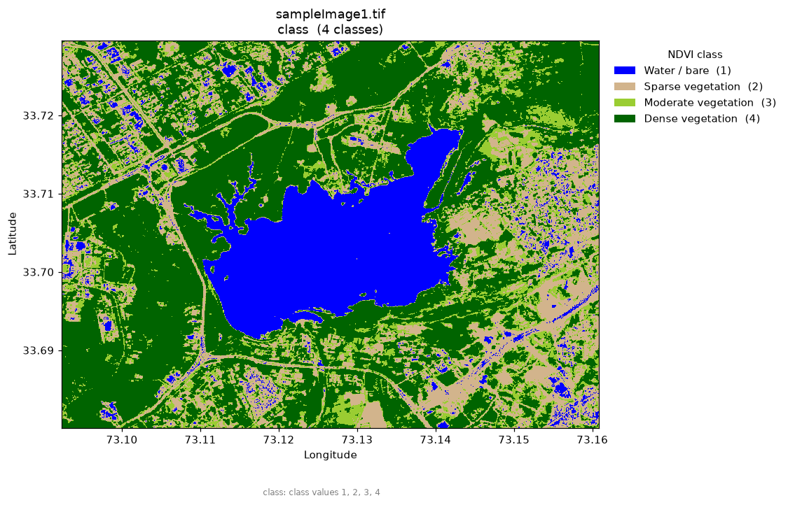

# Reclassify with `where()` and `remap()`

- `Image.where()` **reclassifies a raster**: wherever a condition is true, the pixel value is replaced. Give one rule, or several at once. Use it for ranges, for example NDVI 0.3–0.43 → class 2.
- [`Image.remap()`](#remap-values-with-remap) **replaces exact values** with new values. Use it to recode or merge classes, for example classes 1 and 2 → 1.
- [`eq()`, `selectClasses()`, `mergeClasses()`](#picking-and-merging-classes) **pick or combine classes** in a class map.

```python
ndvi = img.normalizedDifference(["B8", "B4"]).rename("NDVI")

classes = ndvi.where(
    (ndvi.lt(0.1), 1),                          # water / bare
    (ndvi.gte(0.1).And(ndvi.lt(0.34)), 2),      # sparse vegetation
    (ndvi.gte(0.34).And(ndvi.lt(0.5)), 3),      # moderate vegetation
    (ndvi.gte(0.5), 4),                         # dense vegetation
    otherwise=0,
).rename("class")

classes.visualize(
    labels={1: "Water / bare", 2: "Sparse vegetation", 3: "Moderate vegetation", 4: "Dense vegetation"},
    palette=["0000FF", "D2B48C", "9ACD32", "006400"],
    colorbar_label="NDVI class",
)
classes.save("ndvi_classes.tif")
```



## Signature

```python
Image.where(*rules, otherwise=None, save=False)
```

| Parameter | Type | Default | Description |
|---|---|---|---|
| `*rules` | `(test, value)` pairs | – | `test` is an `Image` (a condition). Where it is non-zero, the pixel becomes `value` (a number or an `Image`). See [Rule formats](#rule-formats). |
| `otherwise` | number | `None` | Value for pixels that match no rule. `None` keeps the original value. |
| `save` | `bool` or `str` | `False` | `True` saves `<image>_where_<epoch>.tif`; a string saves to that path. |

**Returns:** `Image` with the same band names as the input.

## How rules are applied

1. Start from the original image, or from `otherwise` if it is given.
2. Apply the rules **in order**. Where a rule's test is true (non-zero), that rule's value is written.
3. Where rules overlap, the **last** matching rule wins. This is the same as chaining several `.where()` calls.
4. Where a test is NoData (NaN), the pixel is not changed by that rule.

## Rule formats

All of these give the same result:

=== "Tuples (recommended)"
    ```python
    ndvi.where((ndvi.lt(0.1), 1), (ndvi.gte(0.5), 2), otherwise=0)
    ```

=== "One rule at a time"
    ```python
    ndvi.where(ndvi.lt(0.1), 1)
    # chain for several rules:
    ndvi.where(ndvi.lt(0.1), 1).where(ndvi.gte(0.5), 2)
    ```

=== "List"
    ```python
    rules = [(ndvi.lt(0.1), 1), (ndvi.gte(0.5), 2)]
    ndvi.where(rules, otherwise=0)
    ```

=== "Dict"
    ```python
    ndvi.where({ndvi.lt(0.1): 1, ndvi.gte(0.5): 2}, otherwise=0)
    ```

=== "Sets"
    ```python
    ndvi.where({ndvi.lt(0.1), 1}, {ndvi.gte(0.5), 2}, otherwise=0)
    ```
    Python sets have no order. This form works only when the value is a **number**: the `Image` is taken as the test and the number as the value. Use tuples when the value is an image.

## Building conditions

Conditions are images of 1 (true) and 0 (false), made with [comparisons and logic](band-math.md#comparisons-and-logic):

| Method | Operator | Meaning |
|---|---|---|
| `x.lt(v)` | `x < v` | less than |
| `x.lte(v)` | `x <= v` | less than or equal |
| `x.gt(v)` | `x > v` | greater than |
| `x.gte(v)` | `x >= v` | greater than or equal |
| `x.eq(v)` | – | equal |
| `x.neq(v)` | – | not equal |
| `a.And(b)` | `a & b` | both true |
| `a.Or(b)` | `a \| b` | either true |
| `a.Not()` | `~a` | not true |

!!! warning "`and` / `or` / `not` don't work on images"
    `and`, `or` and `not` are Python keywords. That means:

    - `ndvi.gt(0.2).and(ndvi.lte(0.3))` is a **`SyntaxError`**. Python rejects it before the code runs.
    - `ndvi.gt(0) and ndvi.lt(1)` raises a `TypeError` that explains what to use instead.

    Use one of these, which all give the same result:

    | Style | AND | OR | NOT |
    |---|---|---|---|
    | Capitalized | `a.And(b)` | `a.Or(b)` | `a.Not()` |
    | Lowercase | `a.and_(b)` | `a.or_(b)` | `a.not_()` |
    | Operators | `a & b` | `a \| b` | `~a` |

    With operators, **use parentheses**: `(ndvi > 0.34) & (ndvi < 0.5)`. In Python, `&` binds more tightly than `>`.

!!! tip "Use `otherwise` for a clean class map"
    Without `otherwise`, pixels that match no rule **keep their original value**. NDVI values below your lowest class would then stay in the result as -0.59, 0.05 and so on. Add `otherwise=0` (or any other value) so every pixel gets a class.

## Range rules

Classes that cover ranges of values are written as two comparisons joined with `And`:

```python
reclassified = ndvi.where(
    (ndvi.gt(0.2).And(ndvi.lte(0.3)), 1),
    (ndvi.gt(0.3).And(ndvi.lte(0.43)), 2),
    (ndvi.gt(0.43).And(ndvi.lte(0.62)), 3),
    (ndvi.gt(0.62), 4),
    otherwise=0,
)
```

Each rule is a pair `(condition, value)`, so check the brackets: the condition's `And(...)` closes **before** the comma and the class value.

## More examples

```python
# Clip negative NDVI to 0, leave everything else unchanged
ndvi.where(ndvi.lt(0), 0)

# Replace values using another image: fill NoData in B8 with B8A
img.select("B8").where(img.select("B8").eq(0), img.select("B8A"))

# Binary mask: 1 = vegetation, 0 = everything else
veg = ndvi.where(ndvi.gte(0.3), 1, otherwise=0)

# Rules built from an expression
water = img.expression("B3 > B8 && B8 < 1500")
landcover = ndvi.where((ndvi.gte(0.4), 2), (water, 1), otherwise=0)

# Reclassify and save in one step
ndvi.where((ndvi.lt(0.2), 1), (ndvi.gte(0.2), 2), otherwise=0, save="veg_classes.tif")
```

## Picking and merging classes

Once you have a class map (for example `classified` from the examples above), these methods pick or combine classes:

| Task | Code | Result |
|---|---|---|
| Pick one class as a mask | `classified.eq(3)` | 1 where class 3, 0 elsewhere |
| Pick several classes as a mask | `classified.eq([3, 4])` | 1 where class 3 **or** 4, 0 elsewhere |
| Everything except some classes | `classified.neq([0, 1])` | 1 where the class is neither 0 nor 1 |
| Keep only some classes | `classified.selectClasses([3, 4])` | class values 3 and 4 kept, all others NoData |
| Merge classes | `classified.mergeClasses([1, 2], into=1)` | classes 1 and 2 become 1, others unchanged |
| Several merges at once | `classified.mergeClasses({1: [1, 2], 2: [3, 4]})` | 1, 2 → 1 and 3, 4 → 2 |
| Imagery for one class only | `img.updateMask(classified.eq(4))` | image pixels only where class 4 |

```python
# Area share of dense vegetation (class 4)
share = classified.eq(4).data.mean()

# Show only the vegetation classes
classified.selectClasses([3, 4]).visualize(labels={3: "Moderate", 4: "Dense"},
                                           palette=["6BBF3A", "006400"])

# Merge 5 classes into 3, then save
classified.mergeClasses({0: [0], 1: [1, 2], 2: [3, 4]}, save="ndvi_3classes.tif")
```

### `eq(value)` / `neq(value)`

`value` can be a number, an `Image`, or a **list of numbers**. With a list, `eq` gives 1 where the pixel equals *any* of the values, and `neq` gives 1 where it equals *none* of them. NoData stays NoData.

### `selectClasses(classes, save=False)`

Keeps the listed class values and turns every other pixel into NoData. `classes` is one number or a list.

### `mergeClasses(classes, into=None, save=False)`

| Parameter | Type | Description |
|---|---|---|
| `classes` | list of numbers, or `dict` | The classes to merge into `into`. Or a dict `{new_value: [old_values]}` for several merges at once (then leave out `into`). |
| `into` | number | The value the merged classes get. Required unless `classes` is a dict. |
| `save` | `bool` or `str` | `True` saves `<image>_mergeClasses_<epoch>.tif`; a string saves to that path. |

Classes not listed keep their value. A class can't be listed in two groups.

## Remap values with `remap()`

`Image.remap()` **replaces specific values with new values**. Use it to recode a class map, for example to merge classes or convert codes from one scheme to another. `where()` works with conditions such as ranges; `remap()` works with exact values.

```python
# 5 NDVI classes (0-4) -> 3 classes
merged = classes.remap([0, 1, 2, 3, 4], [0, 1, 1, 2, 2])

# Same, as a dict {old: new}
merged = classes.remap({0: 0, 1: 1, 2: 1, 3: 2, 4: 2})

merged.visualize(labels={0: "Non-vegetation", 1: "Sparse", 2: "Dense"},
                 palette=["D3D3D3", "C8E66E", "006400"])
```

### Signature

```python
Image.remap(from_values, to_values=None, default=None, save=False)
```

| Parameter | Type | Default | Description |
|---|---|---|---|
| `from_values` | list of numbers, or `dict` | – | The values to replace. Or a dict `{old: new}`, in which case leave out `to_values`. |
| `to_values` | list of numbers | `None` | The new values, one per entry in `from_values`. |
| `default` | number | `None` | Value for pixels whose value isn't listed. `None` keeps their original value. Use `float("nan")` to make them NoData. |
| `save` | `bool` or `str` | `False` | `True` saves `<image>_remap_<epoch>.tif`; a string saves to that path. |

**Returns:** `Image` with the same band names. It applies to every band, and NoData stays NoData.

**Raises:** `ValueError` if the lists are empty, have different lengths, or contain something other than numbers. `TypeError` if `default` is not a number.

### How values are matched

- Values are matched **exactly**, so `remap()` is meant for class or integer values. For continuous data such as NDVI, use [`where()` with ranges](#range-rules).
- Every value is matched against the **original** pixel values. With `remap([1, 2], [2, 3])`, pixels that were 1 become 2 and pixels that were 2 become 3. A 1 is never turned into 3.

### More examples

```python
# Binary mask: classes 3 and 4 -> 1, everything else -> 0
veg = classes.remap([3, 4], [1, 1], default=0)

# Keep only water (class 1); everything else becomes NoData
water_only = classes.remap([1], [1], default=float("nan"))

# Recode and save in one step
classes.remap({1: 10, 2: 20, 3: 30, 4: 40}, save="recoded.tif")
```

## Showing class maps

Pass `labels` to [`visualize()`](raster.md#imagevisualize) to get flat colors and a legend instead of a continuous colorbar:

| Argument | Description |
|---|---|
| `labels` | `{value: "name"}` for each class to show. Pixels with other values are transparent. |
| `palette` | A list with **one color per class** (in order of value), or a palette name to sample from (default `"tab10"`). |
| `colorbar_label` | Legend title (default: the band name). |

`min`, `max` and `gamma` are ignored when `labels` is given.
