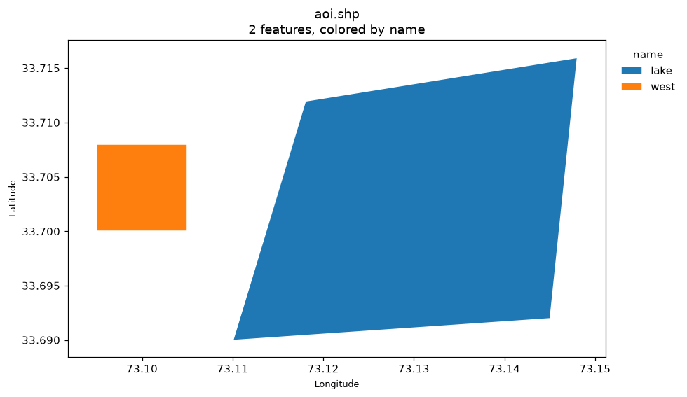
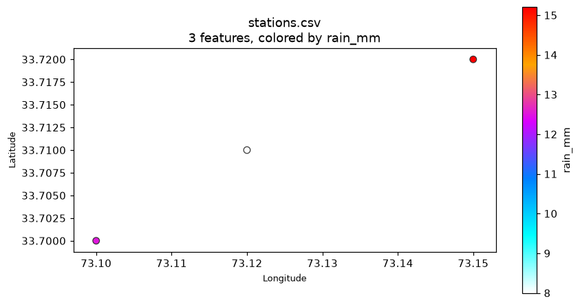
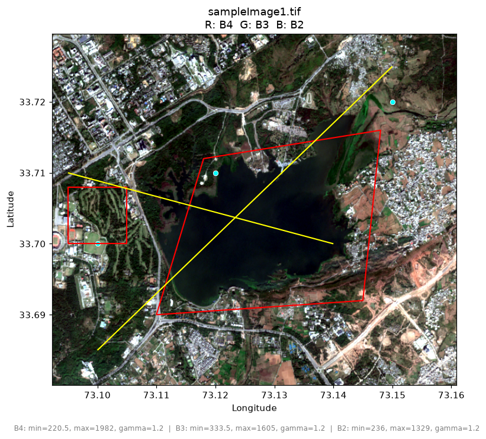

# `vector`: vector files and tables

```python
from pyearthforge import vector
```

Opens vector files (boundaries, points, lines) and tables, shows and filters their records, adds columns, joins datasets, and exports them. Vectors are used to [clip images](raster.md#imageclipgeometry-savefalse), and an image's extent is itself a vector ([`img.geometry()`](raster.md#imagegeometry)).

```python
aoi = vector.Open("boundary.shp")
aoi.meta()
aoi.columns()                    # ['name', 'area_class']

clipped = img.clip(aoi)
img.geometry().save("extent.geojson")
```

- [Sample data](#sample-data)
- [Supported formats](#supported-formats)
- [`vector.Open()`](#vectoropenpath-layernone-xnone-ynone-crsnone)
- [`vector.layers()`](#vectorlayerspath)
- [Creating your own geometries](#creating-your-own-geometries)
- [`Vector` attributes](#vector-attributes)
- [`Vector.meta()`](#vectormeta)
- [`Vector.columnNames()`](#vectorcolumnnames)
- [`Vector.size()`, `hasGeometry()`, `geometryTypes()`](#vectorsize-hasgeometry-geometrytypes)
- [Showing records: `show()`](#showing-records-show)
- [Getting values: `get()`, `first()`](#getting-values-get-first)
- [Filtering: `filter()` and `Filter`](#filtering-filter-and-filter)
- [Sorting: `sort()`, `limit()`](#sorting-sort-limit)
- [Adding columns: `map()` and `Feature`](#adding-columns-map-and-feature)
- [Combining datasets: `merge()`, `join()`, `spatialJoin()`](#combining-datasets-merge-join-spatialjoin)
- [Clustering and PCA of columns](#clustering-and-pca-of-columns)
- [`Vector.visualize()`](#vectorvisualize)
- [Drawing vectors on an image](#drawing-vectors-on-an-image)
- [`Vector.toGeoJSON()`](#vectortogeojson)
- [`Vector.save()`](#vectorsavepath)
- [Tables: CSV, Excel, Parquet](#tables-csv-excel-parquet)

---

## Sample data

The folder `sample_data/` contains example datasets that cover the sample image, used in the examples on this page. Recreate them with `python sample_data/make_sample_data.py`. The data is random but always the same.

| File | Contents |
|---|---|
| `stations.csv` | 600 weather stations: `station_id`, `name`, `district`, `land_cover`, `ndvi`, `longitude`, `latitude`, `elevation_m`, `rain_mm` (about 3% empty), `temp_c`, `install_date`, `active`. The NDVI and land cover come from the sample image at each station. |
| `survey.xlsx` | Sheets `2023` (220 plots) and `2024` (240 plots) with `lon`/`lat` columns; `districts`, a table without coordinates (`district`, `population`, `households`, `area_km2`); and `notes`. |
| `districts.geojson` | 5 district polygons (`district`, `code`, `zone_type`) covering the image. |

```python
from pyearthforge import vector
from pyearthforge.vector import Filter

stations = vector.Open("sample_data/stations.csv")                      # 600 points
districts = vector.Open("sample_data/districts.geojson")                # 5 polygons
population = vector.Open("sample_data/survey.xlsx", layer="districts")  # a table
```

---

## Supported formats

| Format | Extensions | Read | Write | Notes |
|---|---|---|---|---|
| Shapefile | `.shp` | ✓ | ✓ | Keep `.dbf`, `.shx`, `.prj` next to it. |
| GeoJSON | `.geojson`, `.json` | ✓ | ✓ | Written in EPSG:4326. |
| KML | `.kml` | ✓ | ✓ | All folders are combined; written in EPSG:4326. |
| KMZ | `.kmz` | ✓ | – | Zipped KML (Google Earth). |
| GeoPackage | `.gpkg` | ✓ | ✓ | Multi-layer: choose with `layer=`. |
| Parquet / GeoParquet | `.parquet` | ✓ | ✓ | Plain Parquet tables are read like CSV. |
| CSV | `.csv` | ✓ | ✓ | Points from coordinate columns, shapes from a WKT column, or a plain table. |
| Excel | `.xlsx`, `.xls` | ✓ | ✓ (`.xlsx`) | Any sheet: choose with `layer=`. |

---

## `vector.Open(path, layer=None, x=None, y=None, crs=None)`

Opens a vector file or table as a `Vector`. The whole dataset is loaded into memory, which is fine for boundaries, points and tables.

| Parameter | Type | Default | Description |
|---|---|---|---|
| `path` | `str` or `Path` | – | The file to open. |
| `layer` | `str` or `int` | first | Layer of a multi-layer file (GeoPackage, KML folders) or **sheet** of an Excel file, by name or 0-based index. For KML/KMZ, all layers are combined unless you pick one, and a `layer` column records where each feature came from. |
| `x`, `y` | `str` | detected | Column names with point coordinates in a table. See [Tables](#tables-csv-excel-parquet). |
| `crs` | `str` or `int` | – | CRS of the data when the file doesn't define one, e.g. `"EPSG:32643"`. |

**Returns:** `Vector`

**Raises:**
- `VectorNotFoundError` if the file doesn't exist.
- `VectorReadError` if the format is unsupported or the file can't be read.
- `ValueError` if `layer` or `x`/`y` name something that doesn't exist.

```python
aoi = vector.Open("boundary.shp")
sites = vector.Open("sites.kmz")
roads = vector.Open("city.gpkg", layer="roads")
survey = vector.Open("survey.xlsx", layer="2024")         # sheet by name
survey = vector.Open("survey.xlsx", layer=1)              # sheet by index
wells = vector.Open("wells.csv", x="easting", y="northing", crs="EPSG:32643")
```

---

## `vector.layers(path)`

Lists the layers of a file, or the **sheets** of an Excel file.

```python
vector.layers("survey.xlsx")       # ['2023', '2024', 'notes']
vector.layers("city.gpkg")         # ['roads', 'buildings']
```

CSV and Parquet files have no layers, so they return `[]`.

---

## Creating your own geometries

You don't need a file to make a geometry. These functions create a `Vector` from coordinates, GeoJSON or WKT. Use it anywhere a vector is accepted: [`clip()`](raster.md#imageclipgeometry-savefalse), [`sample(region=)`](raster.md#imagesample), [PCA](pca.md#sampling-with-your-own-geometry) and [clustering](clustering.md#sampling-with-your-own-geometry) training, `filterBounds()`, `overlay=`.

| Function | Creates |
|---|---|
| `vector.Rectangle(xmin, ymin, xmax, ymax, crs="EPSG:4326")` | A rectangle from its west, south, east and north edges. |
| `vector.Polygon([(x, y), ...], crs="EPSG:4326")` | A polygon from 3 or more corners (closed automatically). |
| `vector.Point(x, y, crs="EPSG:4326")` | A point; add `.buffer(metres)` for a circle. |
| `vector.fromGeometry(geometry, crs="EPSG:4326", properties=None)` | Anything else: GeoJSON (a geometry, Feature or FeatureCollection), WKT text, shapely shapes, or a list of several. |
| `vector.buffer(distance)` (a method) | Grows each geometry by `distance` metres (negative shrinks). Works in metres for longitude/latitude data too. |

The default CRS `"EPSG:4326"` means **longitude, latitude** in degrees, in that order (x = longitude). For projected coordinates pass the CRS, e.g. `crs="EPSG:32643"` for UTM zone 43N.

```python
from pyearthforge import vector

box = vector.Rectangle(73.11, 33.69, 73.14, 33.71)                    # lon/lat
box_utm = vector.Rectangle(323500, 3729500, 326500, 3731500, crs="EPSG:32643")

lake = vector.Polygon([(73.110, 33.690), (73.145, 33.692), (73.148, 33.716), (73.118, 33.712)])

site = vector.Point(73.125, 33.700)
circle = site.buffer(500)                                              # 500 m around the point

# GeoJSON, e.g. copied from geojson.io (a geometry, a Feature or a FeatureCollection)
drawn = vector.fromGeometry({
    "type": "Polygon",
    "coordinates": [[[73.11, 33.69], [73.14, 33.69], [73.14, 33.71], [73.11, 33.71], [73.11, 33.69]]],
})

# WKT text
wkt = vector.fromGeometry("POLYGON ((73.11 33.69, 73.14 33.69, 73.14 33.71, 73.11 33.69))")

# several training areas with names
from shapely.geometry import box as shape_box
fields = vector.fromGeometry([shape_box(73.10, 33.70, 73.11, 33.71), shape_box(73.15, 33.68, 73.16, 33.69)],
                             properties={"name": ["north field", "south field"]})

corridor = vector.Open("roads.geojson").buffer(50)                     # 50 m each side of the roads
inner = vector.Open("boundary.shp").buffer(-100)                       # 100 m inside the boundary
```

The results are ordinary vectors: `fields.show()`, `fields.visualize()`, `fields.save("fields.geojson")` all work.

**Raises:** `ValueError` for a rectangle with `xmin >= xmax` or `ymin >= ymax`, a polygon with fewer than 3 corners or crossing edges, unreadable WKT, or `properties` with the wrong length; `TypeError` for anything that isn't a geometry.

---

## `Vector` attributes

| Attribute | Type | Description |
|---|---|---|
| `path` | `str` | The file it was opened from. |
| `data` | `GeoDataFrame` | The features, as a geopandas GeoDataFrame. For a table without geometry, this is a pandas DataFrame. |
| `crs` | `pyproj.CRS` or `None` | Coordinate reference system. `None` if unknown or for a plain table. |
| `bounds` | `tuple` or `None` | `(minx, miny, maxx, maxy)` in the vector's CRS. |

```python
aoi.path                                     # 'boundary.shp'
aoi.crs.to_epsg()                            # 4326
minx, miny, maxx, maxy = aoi.bounds
lake = aoi.data[aoi.data["name"] == "lake"]  # any geopandas operation
```

`print(aoi)` shows a one-line summary and the first 5 rows:

```
<Vector stations.csv | 3 features | Point | EPSG:4326>
  station  Latitude  Longitude  rain_mm             geometry
0       A     33.70      73.10     12.5    POINT (73.1 33.7)
1       B     33.71      73.12      8.0  POINT (73.12 33.71)
2       C     33.72      73.15     15.2  POINT (73.15 33.72)
```

---

## `Vector.meta()`

Prints a summary and returns it as a `dict` with `path`, `format`, `layer`, `layers`, `features`, `geometryTypes`, `crs`, `bounds` and `columns` (name → data type).

```python
vector.Open("survey.xlsx", layer="2024").meta()
```
```
==================================================
 Metadata for: survey.xlsx
==================================================
 Format     : Excel
 Layer      : 2024   (available: ['2023', '2024', 'notes'])
 Features   : 3
 Geometry   : Point (3)
 CRS        : EPSG:4326
 Bounds     : (73.100000, 33.700000, 73.150000, 33.720000)
 Columns    : 4
   station    str
   Latitude   float64
   Longitude  float64
   rain_mm    int64
==================================================
```

---

## `Vector.columnNames()`

Returns the attribute column names, like [`bandNames()`](raster.md#imagebandnames) does for images. The geometry column is not included. The result is a `ColumnList`: a normal list with `.size()` and `.get(i)`. `columns()` does the same.

```python
stations.columnNames()               # ['station_id', 'name', 'district', 'land_cover', 'ndvi', ...]
stations.columnNames().size()        # 12
stations.columnNames().get(0)        # 'station_id'
"rain_mm" in stations.columnNames()  # True
aoi.columns()                        # same as aoi.columnNames()
```

---

## `Vector.size()`, `hasGeometry()`, `geometryTypes()`

| Method | Returns |
|---|---|
| `size()` | Number of features (rows). `len(aoi)` also works. |
| `hasGeometry()` | `True` for features with geometries, `False` for a plain table. |
| `geometryTypes()` | Geometry types and their counts, e.g. `{"Polygon": 12, "MultiPolygon": 2}`. |

```python
aoi = vector.Open("boundary.shp")
aoi.size()                                   # 2  (same as len(aoi))
aoi.hasGeometry()                            # True
aoi.geometryTypes()                          # {'Polygon': 2}

vector.Open("population.csv").hasGeometry()  # False: a table without coordinates
vector.Open("stations.csv").geometryTypes()  # {'Point': 3}
```

---

## Showing records: `show()`

```python
Vector.show(n=10, columns=None)
```

Shows records as a table: the first `n`, or all of them with `"all"`. In Jupyter it's displayed as a formatted table; elsewhere it's printed. Geometries appear as short WKT text.

| Parameter | Type | Default | Description |
|---|---|---|---|
| `n` | `int` or `"all"` | `10` | How many records to show from the top. `"all"` (or `None`) shows every record. |
| `columns` | list of `str` | all | Only show these columns. |

```python
stations.show()                                          # first 10
stations.show(25)                                        # first 25
stations.show("all")                                     # all 600
stations.show(3, columns=["station_id", "district", "rain_mm"])
```
```
stations.csv: showing 3 of 600 records
  station_id district  rain_mm
0     ST0001     East      5.8
1     ST0002    North      4.9
2     ST0003    North      6.5
```

Combine it with the other methods: `stations.filter(...).show()`, `stations.sort("rain_mm").show(5)`.

---

## Getting values: `get()`, `first()`

`Vector.get(key)` returns either a column's values or one feature:

| Call | Returns |
|---|---|
| `stations.get("rain_mm")` | All values of the column, as a list. |
| `stations.get(0)` | The feature at that position, as a [`Feature`](#feature). Negative numbers count from the end (`-1` is the last). |
| `stations.first()` | The first feature, the same as `get(0)`. |

```python
rain = stations.get("rain_mm")             # list of 600 values
len(rain), max(r for r in rain if r == r)  # skip the empty (NaN) readings

f = stations.get(0)
f.get("district")                          # 'East'
f.properties()                             # all properties as a dict
stations.get(-1).get("station_id")         # 'ST0600'
```

**Raises:** `ValueError` if the column doesn't exist or the position is out of range; `TypeError` for anything other than a name or a number.

---

## Filtering: `filter()` and `Filter`

`Vector.filter(filter)` keeps the features that pass a condition. Build conditions with `Filter` and combine them with `&` (and), `|` (or) and `~` (not):

```python
from pyearthforge.vector import Filter

north = stations.filter(Filter.eq("district", "North"))
wet = stations.filter(Filter.gt("rain_mm", 20))
north_forest = stations.filter(Filter.eq("district", "North") & Filter.eq("land_cover", "forest"))
not_north = stations.filter(~Filter.eq("district", "North"))
water_or_negative = stations.filter(Filter.Or(Filter.eq("land_cover", "water"), Filter.lt("ndvi", 0)))
north.size()                               # 129
```

| Filter | Keeps features where… |
|---|---|
| `Filter.eq(name, value)` | the property equals `value` |
| `Filter.neq(name, value)` | the property is not `value` |
| `Filter.lt(name, value)` / `Filter.lte(name, value)` | the property is less than (or equal to) `value` |
| `Filter.gt(name, value)` / `Filter.gte(name, value)` | the property is greater than (or equal to) `value` |
| `Filter.rangeContains(name, min, max)` | `min <= property <= max` |
| `Filter.inList(name, values)` | the property is one of `values` |
| `Filter.stringContains(name, text, ignoreCase=False)` | the text contains `text` |
| `Filter.stringStartsWith(name, text)` / `Filter.stringEndsWith(name, text)` | the text starts / ends with `text` |
| `Filter.notNull(name, ...)` | all the given properties have a value |
| `Filter.isNull(name)` | the property is empty (NaN) |
| `Filter.And(f1, f2, ...)` or `f1 & f2` | all filters pass |
| `Filter.Or(f1, f2, ...)` or `f1 \| f2` | any filter passes |
| `Filter.Not(f)` or `~f` | the filter doesn't pass |

```python
stations.filter(Filter.rangeContains("ndvi", 0.2, 0.5))
stations.filter(Filter.inList("district", ["North", "East"]))
stations.filter(Filter.stringContains("name", "lake", ignoreCase=True))
stations.filter(Filter.stringStartsWith("station_id", "ST00"))
stations.filter(Filter.stringEndsWith("name", "0"))     # names ending in 0
stations.filter(Filter.notNull("rain_mm", "temp_c"))
stations.filter(Filter.isNull("rain_mm"))              # 20 stations without a reading
```

Empty values (NaN) never pass a comparison, so `Filter.gt("rain_mm", 20)` skips stations without a reading.

### By location: `filterBounds()`

`Vector.filterBounds(geometry)` keeps the features that intersect a vector or an image's extent. The geometry is reprojected automatically.

```python
central = districts.filter(Filter.eq("district", "Central"))
stations.filterBounds(central).size()      # 105 stations inside the Central district
stations.filterBounds(img)                 # stations inside the image
```

---

## Sorting: `sort()`, `limit()`

| Method | Returns |
|---|---|
| `sort(column, ascending=True)` | All features, sorted by `column`. |
| `limit(n, column=None, ascending=True)` | The first `n` features, sorted by `column` first if given. |

```python
stations.sort("elevation_m").show(5)                      # 5 lowest
stations.limit(10, "rain_mm", ascending=False).show()     # 10 wettest
stations.limit(100)                                       # first 100
```

---

## Adding columns: `map()` and `Feature`

`Vector.map(func)` runs a function on **every feature** and builds a new dataset from what it returns. The function receives a `Feature` and returns a `Feature`:

- `f.set({...})` keeps the geometry and adds or changes properties. This is how you add columns.
- `vector.Feature(geometry, {...})` builds a feature with a new geometry and properties.
- `None` drops the feature.

```python
def add_columns(f):
    rain = f.get("rain_mm")
    return f.set({
        "rain_cm": rain / 10,
        "wet": rain > 20,
        "label": f.get("district") + " / " + f.get("land_cover"),
    })

stations2 = stations.map(add_columns)
stations2.show(3, columns=["station_id", "rain_mm", "rain_cm", "wet", "label"])

# area and perimeter of each district
districts.map(lambda f: f.set({"area_km2": f.area() / 1e6, "perimeter_km": f.length() / 1000}))

# new geometry: district centre points
centres = districts.map(lambda f: vector.Feature(f.centroid(), {"district": f.get("district")}))

# keep only active stations
active = stations.map(lambda f: f if f.get("active") else None)
```

Empty values come through as NaN. `NaN > 20` is `False`, and `NaN / 10` is `NaN`.

### `Feature`

A feature is one geometry plus its properties. Features don't change in place: `set()` returns a new one.

| Method | Returns |
|---|---|
| `vector.Feature(geometry, properties)` | A new feature. `geometry` is a shapely geometry, a GeoJSON dict, or `None`. |
| `f.get(name)` | The value of one property. |
| `f.set({...})` / `f.set(name, value)` | A copy with properties added or changed. |
| `f.properties()` | All properties as a dict. |
| `f.propertyNames()` | The property names. |
| `f.geometry()` | The shapely geometry. |
| `f.area()` | Area in m², measured on the WGS84 ellipsoid for longitude/latitude data. |
| `f.length()` | Length of a line, or perimeter of a polygon, in metres. |
| `f.centroid()` | The centre point. |

```python
from shapely.geometry import Point

f = vector.Feature(Point(73.12, 33.70), {"name": "New station"})
f = f.set("rain_mm", 12.5)
f.get("rain_mm")                    # 12.5
f.propertyNames()                   # ['name', 'rain_mm']
f.geometry()                        # POINT (73.12 33.7)
districts.first().area() / 1e6      # about 6.75 km²
districts.first().centroid()        # POINT (73.1266 33.7048)
```

---

## Combining datasets: `merge()`, `join()`, `spatialJoin()`

| Method | What it does |
|---|---|
| `merge(other)` | Appends the features of `other` (stacks the rows). |
| `join(other, on, right_on=None, how="inner")` | Adds the columns of `other` to each feature by **matching values** in a column. `other` can be a table. |
| `spatialJoin(other, predicate="intersects", how="inner")` | Adds the columns of the features of `other` that each feature **touches** (or lies `"within"`, `"contains"`, ...). |

```python
# merge: both survey years in one dataset
plots = vector.Open("sample_data/survey.xlsx", layer="2023").merge(
        vector.Open("sample_data/survey.xlsx", layer="2024"))
plots.size()                                              # 460

# join by attribute: add population figures to each station
population = vector.Open("sample_data/survey.xlsx", layer="districts")
stations.join(population, on="district").show(3, columns=["station_id", "district", "population"])
districts.join(population, on="district", how="left")      # polygons + population

# join by location: which district polygon is each station in?
with_zone = stations.spatialJoin(districts, predicate="within")
with_zone.show(3, columns=["station_id", "code", "zone_type"])
```

- **`how`:** `"inner"` keeps only features with a match; `"left"` keeps all features, and unmatched ones get empty values.
- **Clashing names:** columns that exist in both datasets get the suffix `_2` from `other` (e.g. `district_2`).
- **Several matches:** in a spatial join, a feature that matches several features of `other` appears once per match.
- **Reprojection:** `other` is reprojected to this dataset's CRS automatically.

---

## Clustering and PCA of columns

`Vector.cluster(clusterer, outputName="cluster", columns=None, region=None)` adds each row's cluster number. Give a trained clusterer, or an untrained one to train it on `columns` (only on the rows inside `region` if given). `Vector.pca(model, columns=None, standardize=False)` adds principal-component columns `PC1`, `PC2`, ... Rows with an empty input value get empty results. See [Clustering](clustering.md#clustering-tables) and [PCA](pca.md#vectorpcamodel-columnsnone-standardizefalse).

```python
from pyearthforge import cluster

trained = cluster.kMeans(4, normalize=True).train(stations, inputProperties=["ndvi", "elevation_m", "temp_c"])
grouped = stations.cluster(trained)
grouped.show(5, columns=["station_id", "ndvi", "elevation_m", "cluster"])
stations.cluster(cluster.kMeans(3), columns=["ndvi", "temp_c"], region=central)   # train in one step

with_pcs = stations.pca(2, columns=["ndvi", "elevation_m", "rain_mm", "temp_c"], standardize=True)
with_pcs.show(5, columns=["station_id", "PC1", "PC2"])
```

---

## `Vector.visualize()`

```python
Vector.visualize(column=None, palette=None, color=None, edgecolor=None, linewidth=1.0,
                 legend=True, save_chart=False, dpi=200)
```

Draws the geometries as a map chart. Polygons are drawn filled with an outline, lines as lines and points as dots. The axes show map coordinates (longitude/latitude for geographic CRSs).

| Parameter | Type | Default | Description |
|---|---|---|---|
| `column` | `str` | – | Attribute column to color the features by. **Numbers** get a palette and a colorbar; **text** gets one color per value and a legend. |
| `palette` | `str` or list | `"viridis"` (numbers), `"tab10"` (text) | Palette for `column`: any [built-in palette](palettes.md), matplotlib colormap or list of colors. |
| `color` | `str` | green | Fill color when no `column` is given. `"none"` draws outlines only. |
| `edgecolor` | `str` | dark green | Outline color. When coloring by `column`, the default is white for polygons and dark grey for points. |
| `linewidth` | `float` | `1.0` | Outline or line width. |
| `legend` | `bool` | `True` | Show the colorbar or legend when `column` is given. |
| `save_chart` | `bool` | `False` | Also save the chart as `<file name>_<epoch>.png` in the current folder. |
| `dpi` | `int` | `200` | Resolution of the saved PNG. |

**Returns:** the saved file name when `save_chart=True`, otherwise `None`.

**Raises:** `ValueError` if the dataset is a table without geometries, or `column` doesn't exist.

```python
aoi = vector.Open("boundary.shp")
aoi.visualize()                                          # filled shapes with outlines
aoi.visualize(color="none", edgecolor="red")             # outlines only
aoi.visualize(column="name")                             # one color per name, with a legend

stations = vector.Open("stations.csv")
stations.visualize(column="rain_mm", palette="precipitation", save_chart=True)
```

| `aoi.visualize(column="name")` | `stations.visualize(column="rain_mm", palette="precipitation")` |
|---|---|
|  |  |

For more control (labels, basemaps, custom styling), use geopandas directly: `aoi.data.plot(...)`.

---

## Drawing vectors on an image

Pass vectors to [`Image.visualize()`](raster.md#imagevisualize) with `overlay=` to draw them on top of the image. Polygons are drawn as outlines, lines as lines and points as dots. Vectors in another CRS are reprojected to the image's CRS, and the map keeps the image's extent.

```python
img.visualize(bands=["B4", "B3", "B2"], overlay=aoi)                       # red outlines
img.visualize(bands=["B4", "B3", "B2"], overlay=aoi, overlay_color="yellow")

# several vectors, one color each
img.visualize(bands=["B4", "B3", "B2"], gamma=1.2,
              overlay=[aoi, roads, stations], overlay_color=["red", "yellow", "cyan"])

# on an index too
img.normalizedDifference(["B8", "B4"]).visualize(min=-0.2, max=0.8, palette="ndvi", overlay=aoi)
```

{ width="75%" }

---

## `Vector.toGeoJSON()`

Returns the features as a GeoJSON `dict`, with coordinates in EPSG:4326 (longitude, latitude).

```python
gj = img.geometry().toGeoJSON()
gj["features"][0]["geometry"]["coordinates"]
# [[[73.09232, 33.72958], [73.16086, 33.72958], [73.16086, 33.68009], [73.09232, 33.68009], [73.09232, 33.72958]]]
```

---

## `Vector.save(path)`

Writes the dataset to a file. The format is chosen from the extension: `.geojson`/`.json`, `.shp`, `.gpkg`, `.kml`, `.parquet`, `.csv` or `.xlsx`.

- GeoJSON and KML are always written in **EPSG:4326**, as those formats require. Other formats keep the vector's CRS.
- In `.csv` and `.xlsx`, geometries are written as WKT text in a `geometry` column. Opening that file again turns them back into shapes.
- Tables without geometry can only be saved as `.csv`, `.xlsx` or `.parquet`.

**Returns:** the absolute path of the saved file.

```python
img.geometry().save("extent.geojson")
aoi.save("aoi.gpkg")
vector.Open("survey.xlsx", layer="2024").save("survey_2024.geojson")    # table → GeoJSON points
```

---

## Tables: CSV, Excel, Parquet

Tables are turned into features automatically:

1. **Coordinate columns → points.** Recognised names (case-insensitive) are `longitude`/`lon`/`long`/`lng`/`x` and `latitude`/`lat`/`y`. Name them yourself with `x=` and `y=`. When all values are within ±180 / ±90, the CRS is assumed to be EPSG:4326; otherwise pass `crs=`.
2. **WKT column → shapes.** A column named `wkt`, `geometry`, `geom`, `the_geom` or `shape` that contains WKT text such as `POLYGON ((…))`. Pass `crs=`, because WKT doesn't record a CRS.
3. **Otherwise → a plain table.** `meta()`, `columns()`, `size()`, `data` and `save()` (as `.csv`, `.xlsx` or `.parquet`) still work, but it can't be used to clip.

GeoParquet files (Parquet with geometry metadata, for example written by geopandas) are read directly with their CRS.
